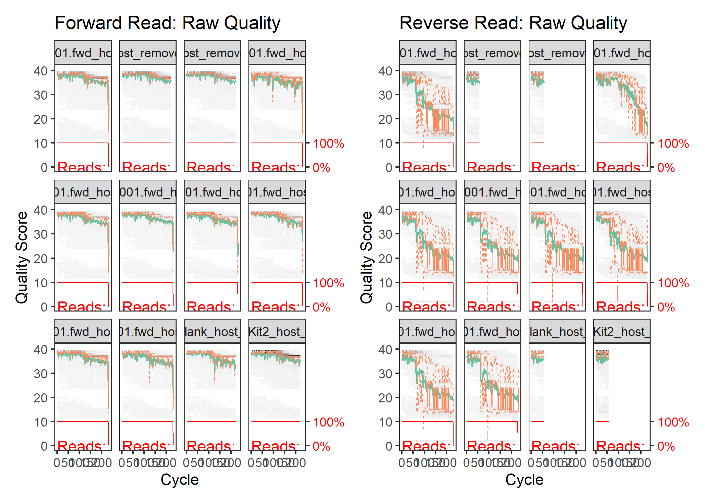
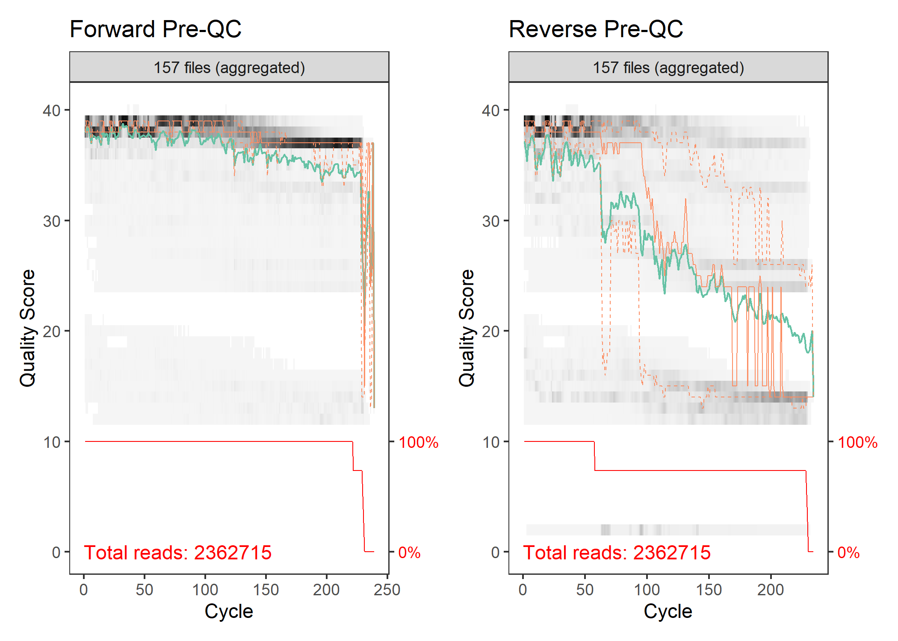
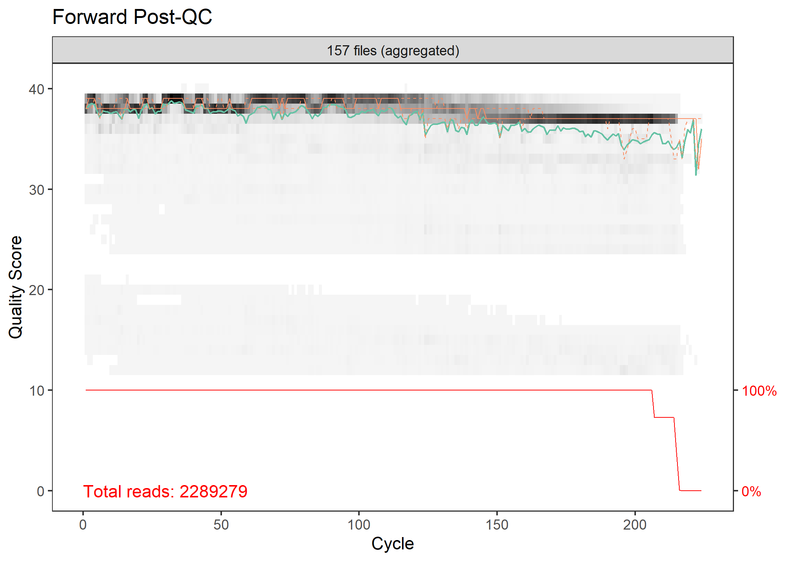
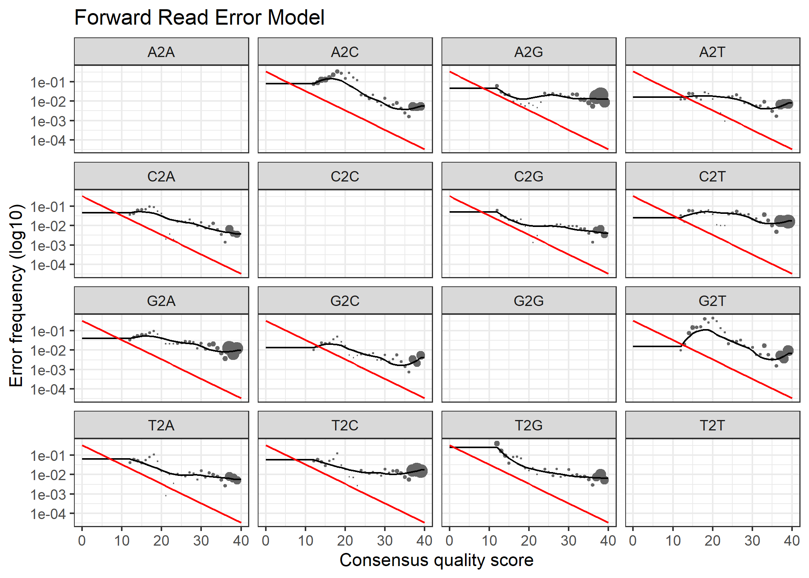
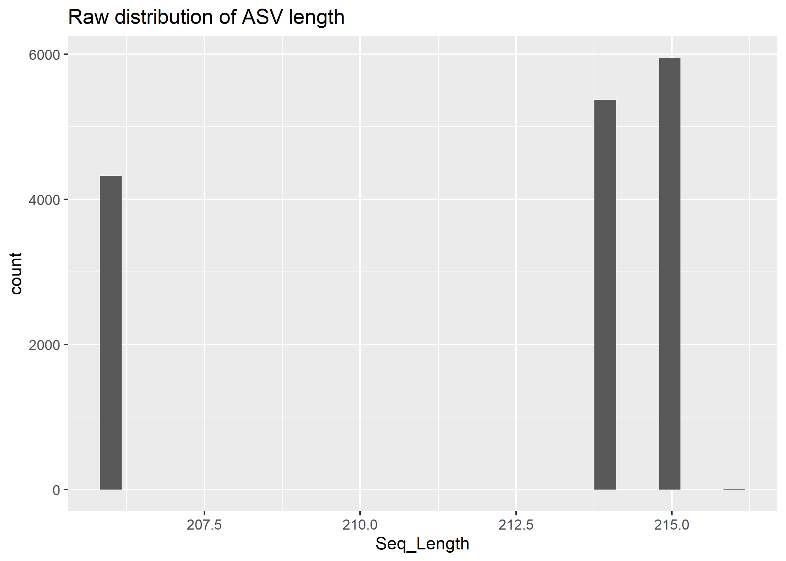

#### Purpose of this file  

This file contains all of the code for producing a curated OTU table from the 16S microbial sequence data for the Armstrong et al. manuscript entitled **"XXX"**, published by [XXX](https://doi.org/10.1093/femsec/fiaa029).

##### If you have any questions, you are welcome to email the corresponding author at eja98@cornell.edu or tweet him at [EricJ_Armstrong](https://x.com/EricJ_Armstrong).

# 1 - Process Raw FastQ Files
*Note:* The fastq files containing 16S sequences were prepared from the raw sequence files using CutAdapt (v5.1) implemented within python (v3.9) with the following Unix commands:

``` bash
# cd /drives/d/Eric_Seq/BIOcean5D/SequencingData/Sequences_16S/RawSeqs

# for read1 in *R1_001.fastq.gz; do read2=$(echo $read1| sed 's/R1_001.fastq.gz/R2_001.fastq.gz/'); py -m cutadapt -O 12 --discard-untrimmed -g TCGTCGGCAGCGTCAGATGTGTATAAGAGACAGNNGTGYCAGCMGCCGCGGTAA -g TCGTCGGCAGCGTCAGATGTGTATAAGAGACAGNNNGTGYCAGCNGCCGCGGTAA -G GTCTCGTGGGCTCGGAGATGTGTATAAGAGACAGNNCCGYCAATTYMTTTRAGTTT -G GTCTCGTGGGCTCGGAGATGTGTATAAGAGACAGNNNCCGYCAATTYMTTTRAGTTT -o ../CutAdapt/TMPFiles/${read1%_R1_001.fastq.gz}.tmp.fwd_R1_001.fastq.gz -p ../CutAdapt/TMPFiles/${read2%_R2_001.fastq.gz}.tmp.fwd_R2_001.fastq.gz $read1 $read2 -j 8 --pair-adapters --minimum-length 75; done

# for read1 in *R1_001.fastq.gz; do read2=$(echo $read1| sed 's/R1_001.fastq.gz/R2_001.fastq.gz/'); py -m cutadapt -O 12 --discard-untrimmed -G TCGTCGGCAGCGTCAGATGTGTATAAGAGACAGNNGTGYCAGCMGCCGCGGTAA -G TCGTCGGCAGCGTCAGATGTGTATAAGAGACAGNNNGTGYCAGCNGCCGCGGTAA -g GTCTCGTGGGCTCGGAGATGTGTATAAGAGACAGNNCCGYCAATTYMTTTRAGTTT -g GTCTCGTGGGCTCGGAGATGTGTATAAGAGACAGNNNCCGYCAATTYMTTTRAGTTT -o ../CutAdapt/TMPFiles/${read1%_R1_001.fastq.gz}.tmp.rev_R1_001.fastq.gz -p ../CutAdapt/TMPFiles/${read2%_R2_001.fastq.gz}.tmp.rev_R2_001.fastq.gz $read1 $read2 -j 8 --pair-adapters --minimum-length 75; done

# cd /drives/d/Eric_Seq/BIOcean5D/SequencingData/Sequences_16S/CutAdapt/TMPFiles

# for readFWD1 in *tmp.fwd_R1_001.fastq.gz; do py -m cutadapt -O 12 --times 5 -g GTGYCAGCMGCCGCGGTAA -o ../CleanSeqs/${readFWD1%.tmp.fwd_R1_001.fastq.gz}.fwd_R1_001.fastq.gz -j 8 $readFWD1;done

# for readFWD2 in *tmp.fwd_R2_001.fastq.gz; do py -m cutadapt -O 12 --times 5 -g CCGYCAATTYMTTTRAGTTT -o ../CleanSeqs/${readFWD2%.tmp.fwd_R2_001.fastq.gz}.fwd_R2_001.fastq.gz -j 8 $readFWD2;done

# for readREV1 in *tmp.rev_R1_001.fastq.gz; do py -m cutadapt -O 12 --times 5 -g TCGTCGGCAGCGTCAGATGTGTATAAGAGACAGNNGTGYCAGCMGCCGCGGTAA -g TCGTCGGCAGCGTCAGATGTGTATAAGAGACAGNNNGTGYCAGCNGCCGCGGTAA -o ../CleanSeqs/${readFWD1%.tmp.fwd_R1_001.fastq.gz}.fwd_R1_001.fastq.gz -j 8 $readFWD1;done

# for readREV2 in *tmp.rev_R2_001.fastq.gz; do py -m cutadapt -O 12 --times 5 -g GTCTCGTGGGCTCGGAGATGTGTATAAGAGACAGNNCCGYCAATTYMTTTRAGTTT -g GTCTCGTGGGCTCGGAGATGTGTATAAGAGACAGNNNCCGYCAATTYMTTTRAGTTT -o ../CleanSeqs/${readFWD2%.tmp.fwd_R2_001.fastq.gz}.fwd_R2_001.fastq.gz -j 8 $readFWD2;done

# # Removing the host sequences

# /programs/bowtie2-2.5.1-linux-x86_64/bowtie2-build GCA_964035705.1_jaPorRusx1.1_genomic.fa.gz hostPOR_DB

# ls *_R1*.gz | while read a ; do /programs/bowtie2-2.5.1-linux-x86_64/bowtie2 -p 8 -x /workdir/eja98/POCPOR_BIO5D/References/Porites/hostPOR_DB -1 $a -2 ${a%_R1_001.fastq.gz}_R2_001.fastq.gz -S ${a%_R1_001.fastq.gz}_mapped_and_unmapped.sam;done

# ls *mapped_and_unmapped.sam | while read a; do samtools view -bS $a > ${a%.sam}.bam;done

# ls *_mapped_and_unmapped.bam | while read a; do samtools view -b -f 12 -F 256 $a > ${a%_mapped_and_unmapped.bam}_bothReadsUnmapped.bam;done

# ls *_bothReadsUnmapped.bam | while read a; do samtools sort -n -m 5G -@ 2 $a -o ${a%.bam}_sorted.bam;done

# ls *_bothReadsUnmapped_sorted.bam > list_of_files.txt

# for file in $(cat list_of_files.txt); do samtools fastq -@ 8 -1 ${file%_bothReadsUnmapped_sorted.bam}_host_removed_R1_001.fastq.gz -2 ${file%_bothReadsUnmapped_sorted.bam}_host_removed_R2_001.fastq.gz -s ${file%_bothReadsUnmapped_sorted.bam}.singletons.fastq.gz  -0 /dev/null -n $file ;done
```

# 2 - Prepare Workspace
Load necessary R packages and set default parameters

## 2.1 - Define Paths

``` r
# a - Define the main project directory ----
  dir_proj <- 
  "C:/Users/uax75/OneDrive/Documents/R/AAC-BIOcean5D-Coral_Microbiome/"
  setwd(dir_proj)

# b - Define the directory containing the input data ----
  dir_in <- 
    "C:/Users/uax75/OneDrive/Documents/R/AAC-BIOcean5D-Coral_Microbiome/Data/"

# c - Define the directories that will contain output Files/Figures/Tables ----
  dir_out_dat <- 
    "C:/Users/uax75/OneDrive/Documents/R/AAC-BIOcean5D-Coral_Microbiome/Data/01-AAC-AssignSeqVariants/"
  dir.create(dir_out_dat, recursive = TRUE)
  dir_out_fig <- 
    "C:/Users/uax75/OneDrive/Documents/R/AAC-BIOcean5D-Coral_Microbiome/Figures/01-AAC-AssignSeqVariants/"
  dir.create(dir_out_fig, recursive = TRUE)
  dir_out_tab <- 
    "C:/Users/uax75/OneDrive/Documents/R/AAC-BIOcean5D-Coral_Microbiome/Tables/01-AAC-AssignSeqVariants/" 
  dir.create(dir_out_tab, recursive = TRUE)
  
  dir.create(paste(dir_out_dat, "DADA2-Results", sep = ""))
    
    
```

## 2.2 - Set Defaults

``` r
# a - Define the output prefix for generated files ----
  pref_out <- "01-AAC-AssignSeqVariants_"
    
# b - Set the random seed value ----
  set.seed(123)

```

## 2.3 - Load Libraries

``` r
# a - load necessary packages ----
  pacman::p_load(devtools, phyloseq, dada2, patchwork,
                 Biostrings, tidyverse, ggpubr, rstatix, ggplot2, 
                 install = FALSE)

```

# 3 - Import Data
## 3.1 - Load Sequence Files

``` r
# a - Set the path to the Host Removed FastQ files ----
  fastq_path <- paste(dir_in,
                      "00-AAC-Sequences/CleanBactSeqs/",
                      sep = "")

  
# b - Reading in the forward and reverse 16S FastQ files ----
  # Forward and reverse fastq filenames have format: 
  # SAMPLENAME_R1_001.fastq.gz and SAMPLENAME_R2_001.fastq.gz

  filesF <- sort(
    list.files(fastq_path, pattern="_R1_001.fastq.gz", full.names = TRUE))
  filesR <- sort(
    list.files(fastq_path, pattern="_R2_001.fastq.gz", full.names = TRUE))

# c - Flag and Remove FastQ files from Empty Wells ----
  
  # Identify low read count files

  samples_bad <- c("84-OBC04F60POR", "56-OBC01F40POC", "neg-pcr2")
  samples_bad_combined <- paste(samples_bad, collapse = "|")
  
  badFilesF <- grep(samples_bad_combined, 
                    filesF, value = TRUE)
  badFilesR <- grep(samples_bad_combined, 
                    filesR, value = TRUE)

  # Remove flagged FastQ files prior to analysis with DADA2
  filesF <- filesF[!filesF %in% c(badFilesF)]
  filesR <- filesR[!filesR %in% c(badFilesR)]

# d - Extract sample names from FastQ filenames ----
  # NOTE: This code assumes filenames have the format: SAMPLENAME_XXX.fastq.gz
  sample_names <- sapply(strsplit(basename(filesF), "_"), `[`, 1)
  sample_names <- gsub("^([^_]*_[^_]*).*", "\\1", basename(filesF))
  sample_names <- sub("_.*", "", gsub("_host", "", sample_names))

```

# 4 - Assess Raw Read Quality
Evaluate raw sequence quality

## 4.1 - Individual Sample Read Quality Plots
Let’s see the quality of the raw reads before we trim
Plot 12 random samples

``` r
# a - Randomly select 12 samples from dataset to evaluate ----
  samples_random <- sample(1:length(filesF), size = 12)
  samples_random
#>  [1]  14  50 118  43 157 155  90  91 150  92 137  99

# b - Calculate and plot quality of these samples ----
  plot_forward_filteredQual <- 
    plotQualityProfile(filesF[samples_random]) + 
    labs(title = "Forward Read: Raw Quality")
  
  plot_reverse_filteredQual <- 
    plotQualityProfile(filesR[samples_random]) + 
    labs(title = "Reverse Read: Raw Quality")


# c - Plot them together with patchwork ----
  plot_forward_filteredQual + plot_reverse_filteredQual
```



## 4.2 - Sample Aggregate Read Quality Plots 

``` r
# a - Forward reads ----
  plot_forward_preQC <-
    plotQualityProfile(filesF, aggregate = TRUE) +
    labs(title = "Forward Pre-QC")

# b - Reverse reads ----
  plot_reverse_preQC <-
    plotQualityProfile(filesR, aggregate = TRUE) +
    labs(title = "Reverse Pre-QC")

# c - Plot Forward and Reverse Together ----
  plot_preQC_aggregate <-
    # Plot the forward and reverse together
    plot_forward_preQC + plot_reverse_preQC

  # Show the plot
  plot_preQC_aggregate
```



``` r
  
  ggsave(
  filename = paste(dir_out_fig, "plot_preQC_aggregate.png", sep = ""),
  plot = plot_preQC_aggregate,
  width = 20,       # Width of the output
  height = 20,      # Height of the output
  units = "in",     # Units for width/height ("in", "cm", "mm", "px")
  dpi = 300         # Resolution (300 is standard for print)
)

  ggsave(
  filename = paste(dir_out_fig, "plot_preQC_aggregate.pdf", sep = ""),
  plot = plot_preQC_aggregate,
  width = 20,       # Width of the output
  height = 20,      # Height of the output
  units = "in",     # Units for width/height ("in", "cm", "mm", "px")
  dpi = 300         # Resolution (300 is standard for print)
)
```

Here, we see that the plots are showing the standard Illumina output: The quality is higher at the beginning of the read and slowly gets worse and worse as the read progresses. This is typical of Illumina sequencing because of phasing. We also see that there’s a slightly lower quality in the reverse reads due to the less efficient chemistry.

Note: The first few bases at the beginning of the forward reads have a VERY LOW quality base. Take a look at the multiQC report to explore the data and confirm what you see here in the dada2 plot.

# 5 - Running Quality Control
## 5.1 - Read Filtering and Trimming
Here we remove low quality tails of the sequences and also trim a certain number of bases from each sequence as dada2 only supports exact merging. This step has to be executed twice per readset - once for fw and once for rev orientation reads.

Parameters of filter and trim *DEPEND ON THE DATASET*. 
The things to keep in mind are:
- The library preparation: Are the primers included in the sequence? If so, they need to be trimmed out in this step.
- What do the above quality profiles of the reads look like? If they are lower quality, it is highly recommended to use maxEE = c(1,1).
- Do the reads dip suddenly in their quality? If so, explore trimLeft and truncLen

Check out more of the parameters using ?filterAndTrim to bring up the help page and do some googling about it. Some notes with a description of a few of the parameters:

    Lower quality datasets: If the sequence quality is lower, it’s recommended to use maxEE = c(1,1). When reverse reads are of much lower quality, which is typical for Illumina sequencing, these can be truncated at a lower value, where the Phred Scores drop below about 30.
    
    maxEE is a quality filtering threshold applied to expected errors. Here, if there’s 2 expected errors. It’s ok. But more than 2. Throw away the sequence. Two values, first is for forward reads; second is for reverse reads.
    trimLeft can be used to remove the beginning bases of a read (e.g. to trim out primers!)
    truncLen can be used to trim your sequences after a specific base pair when the quality gets lower. Though, please note that this will shorten the ASVs! For example, this can be used when the quality of the sequence suddenly gets lower, or clearly is typically lower. So, if the quality of the read drops below a phred score of 25 (on the y-axis of the plotQualityProfile above, which indicates ~99.5% confidence per base).
    maxN the number of N bases. Here, using ASVs, we should ALWAYS remove all Ns from the data.


``` r
# a - Designate the directory where filtered files will be placed ----
  filtFold <- file.path(
    paste(dir_out_dat,
          "DADAFilteredSeqs",
          sep = ""))
  dir.create(filtFold, recursive = TRUE)

# b - Create lists with the names of the filtered reads to be generated ----
  filtF <- 
    file.path(filtFold, paste0(sample_names, "_R1_filtered.fastq.gz"))
  filtR <- 
    file.path(filtFold, paste0(sample_names, "_R2_filtered.fastq.gz"))

# c - Filter and trim sequence files ----
  # Note: Here we have not analyzed reverse reads alongside forward reads because their quality was so low that they caused massive loss of sequences after filtering. For further discussion of this option see here:
  # https://forum.qiime2.org/t/using-dada2-losing-50-of-reads-after-filtering-and-80-of-reads-by-the-end/12745/3
  filtered_reads <- filterAndTrim(filesF, filtF, 
                     truncQ = 3, maxEE = 2,#maxEE = c(2, 5), 
                     maxN = 0, rm.phix=TRUE,
                     compress = TRUE, verbose=TRUE, 
                     multithread = FALSE, # On Windows set multithread=FALSE
                     minLen = 150,
                     trimRight = 15 #trimRight = c(15, 15)
                     #truncLen = 240 #truncLen=c(240,100)
              ) 
  
  head(filtered_reads)
#>                                                           reads.in reads.out
#> 1-TGC01F00POC_S78_L001.fwd_host_removed_R1_001.fastq.gz      13152     12722
#> 10-OGC05F00POC_S89_L001.fwd_host_removed_R1_001.fastq.gz     22784     21642
#> 100-TBC01F60POC_S28_L001.fwd_host_removed_R1_001.fastq.gz    10394     10078
#> 101-TBC02F60POC_S36_L001.fwd_host_removed_R1_001.fastq.gz    11893     11576
#> 102-TBC03F60POC_S44_L001.fwd_host_removed_R1_001.fastq.gz    13865     13353
#> 103-TBC04F60POC_S52_L001.fwd_host_removed_R1_001.fastq.gz    12880     12456
```

## 5.3 - Aggregated Sample Read Quality Plots Post-Trimming 

``` r
# a - Forward reads ----
  plot_forward_postQC <-
    plotQualityProfile(filtF, aggregate = TRUE) +
    labs(title = "Forward Post-QC")

# c - Aggregate QC ----
  plot_postQC_aggregate <-
    # Plot the forward and reverse together
    plot_forward_postQC

  # Show the plot
  plot_postQC_aggregate
```



``` r
  
    ggsave(
  filename = paste(dir_out_fig, "plot_postQC_aggregate.png", sep = ""),
  plot = plot_postQC_aggregate,
  width = 20,       # Width of the output
  height = 20,      # Height of the output
  units = "in",     # Units for width/height ("in", "cm", "mm", "px")
  dpi = 300         # Resolution (300 is standard for print)
)

	ggsave(
  filename = paste(dir_out_fig, "plot_postQC_aggregate.pdf", sep = ""),
  plot = plot_postQC_aggregate,
  width = 20,       # Width of the output
  height = 20,      # Height of the output
  units = "in",     # Units for width/height ("in", "cm", "mm", "px")
  dpi = 300         # Resolution (300 is standard for print)
)
```

## 5.4 - Stats on read output from filterAndTrim

``` r
# a - Make output into dataframe ----
  df_filtered <- as.data.frame(filtered_reads)
  head(df_filtered)
#>                                                           reads.in reads.out
#> 1-TGC01F00POC_S78_L001.fwd_host_removed_R1_001.fastq.gz      13152     12722
#> 10-OGC05F00POC_S89_L001.fwd_host_removed_R1_001.fastq.gz     22784     21642
#> 100-TBC01F60POC_S28_L001.fwd_host_removed_R1_001.fastq.gz    10394     10078
#> 101-TBC02F60POC_S36_L001.fwd_host_removed_R1_001.fastq.gz    11893     11576
#> 102-TBC03F60POC_S44_L001.fwd_host_removed_R1_001.fastq.gz    13865     13353
#> 103-TBC04F60POC_S52_L001.fwd_host_removed_R1_001.fastq.gz    12880     12456
  
# b - calculate some stats ----
  df_filtered %>%
    reframe(median_reads_in = median(reads.in),
            median_reads_out = median(reads.out),
            median_percent_retained = (median(reads.out)/median(reads.in)))
#>   median_reads_in median_reads_out median_percent_retained
#> 1           13273            12846               0.9678294
  
# c - Plot the pre and post together in one plot ----
  plot_both <- plot_preQC_aggregate / plot_postQC_aggregate
  
    ggsave(
  filename = paste(dir_out_fig, "plot_preVSpost.png", sep = ""),
  plot = plot_both,
  width = 20,       # Width of the output
  height = 20,      # Height of the output
  units = "in",     # Units for width/height ("in", "cm", "mm", "px")
  dpi = 300         # Resolution (300 is standard for print)
)

	ggsave(
  filename = paste(dir_out_fig, "plot_preVSpost.pdf", sep = ""),
  plot = plot_both,
  width = 20,       # Width of the output
  height = 20,      # Height of the output
  units = "in",     # Units for width/height ("in", "cm", "mm", "px")
  dpi = 300         # Resolution (300 is standard for print)
)
```


# 6 - Learning Errors
In this step we need to learn the lane specific error model. We do that for all samples that come from one lane at once but separate for R1 and R2 and fw and rev

``` r
# a - List the filtered FastQ files that were actually written ----
  filtF <- sort(
    list.files(filtFold, pattern="_R1_filtered.fastq", full.names = TRUE))

# b - List the filtered sample names
  sample_names_filt <- 
    sub("_.*", "", gsub("^([^_]*_[^_]*_[^_]*).*$", "\\1", basename(filtF)))

#c - Estimate the error model ----
  errF <- learnErrors(filtF, multithread = TRUE)
#> 101291500 total bases in 472131 reads from 33 samples will be used for learning the error rates.
  
  # It is always worthwhile, as a sanity check if nothing else, to visualize the estimated error rates:
  
  # Plot Forward  
  plot_forward_error <- 
    plotErrors(errF, nominalQ = TRUE) + 
    labs(title = "Forward Read Error Model")

  # Put the two plots together
  plot_forward_error
```



# 7 - Dereplication
Dereplication combines all identical sequencing reads into “unique sequences” with a corresponding “abundance” equal to the number of reads with that unique sequence. Dereplication substantially reduces computation time by eliminating redundant comparisons.

Dereplication in the DADA2 pipeline has one crucial addition from other pipelines: DADA2 retains a summary of the quality information associated with each unique sequence. The consensus quality profile of a unique sequence is the average of the positional qualities from the dereplicated reads. These quality profiles inform the error model of the subsequent sample inference step, significantly increasing DADA2’s accuracy.

``` r
# a - Dereplicate the sequences ----
  derepF <- dada2::derepFastq(filtF, verbose=TRUE)
  

# b - Add samples names to the derep-class object ----
  names(derepF) <- sample_names_filt
```

# 8 - Infer ASVs
This is the core function of dada2. Each read, its abundance, and its quality is tested if it's an actual, error-free, ASV or if it's a spurious sequence with errors. The error function from the previous step is reused. The sample inference step is run for each lane individually and split by R1 / R2 and fw / rev.

``` r
# a - Perform  ASV Inference ----
  dadaF <- dada(derepF, err = errF, multithread = TRUE)
#> Sample 1 - 12722 reads in 4569 unique sequences.
#> Sample 2 - 21642 reads in 11036 unique sequences.
#> Sample 3 - 10078 reads in 3284 unique sequences.
#> Sample 4 - 11576 reads in 5209 unique sequences.
#> Sample 5 - 13353 reads in 4172 unique sequences.
#> Sample 6 - 12456 reads in 5128 unique sequences.
#> Sample 7 - 15938 reads in 6762 unique sequences.
#> Sample 8 - 27362 reads in 20084 unique sequences.
#> Sample 9 - 26365 reads in 22069 unique sequences.
#> Sample 10 - 3311 reads in 2118 unique sequences.
#> Sample 11 - 17152 reads in 10445 unique sequences.
#> Sample 12 - 10346 reads in 5474 unique sequences.
#> Sample 13 - 14669 reads in 7238 unique sequences.
#> Sample 14 - 24232 reads in 16355 unique sequences.
#> Sample 15 - 21887 reads in 11378 unique sequences.
#> Sample 16 - 16460 reads in 8699 unique sequences.
#> Sample 17 - 19760 reads in 7841 unique sequences.
#> Sample 18 - 9593 reads in 5027 unique sequences.
#> Sample 19 - 13696 reads in 5320 unique sequences.
#> Sample 20 - 21095 reads in 9220 unique sequences.
#> Sample 21 - 17040 reads in 12545 unique sequences.
#> Sample 22 - 9553 reads in 4967 unique sequences.
#> Sample 23 - 13791 reads in 9112 unique sequences.
#> Sample 24 - 10933 reads in 6417 unique sequences.
#> Sample 25 - 10145 reads in 6394 unique sequences.
#> Sample 26 - 4756 reads in 2620 unique sequences.
#> Sample 27 - 2889 reads in 2029 unique sequences.
#> Sample 28 - 19633 reads in 11921 unique sequences.
#> Sample 29 - 5651 reads in 3040 unique sequences.
#> Sample 30 - 14353 reads in 7970 unique sequences.
#> Sample 31 - 11950 reads in 6830 unique sequences.
#> Sample 32 - 12911 reads in 6320 unique sequences.
#> Sample 33 - 14833 reads in 5465 unique sequences.
#> Sample 34 - 10126 reads in 3706 unique sequences.
#> Sample 35 - 12295 reads in 6040 unique sequences.
#> Sample 36 - 16891 reads in 10458 unique sequences.
#> Sample 37 - 21671 reads in 8921 unique sequences.
#> Sample 38 - 8844 reads in 4921 unique sequences.
#> Sample 39 - 8271 reads in 4539 unique sequences.
#> Sample 40 - 12561 reads in 7096 unique sequences.
#> Sample 41 - 24401 reads in 14705 unique sequences.
#> Sample 42 - 19153 reads in 10406 unique sequences.
#> Sample 43 - 28508 reads in 12708 unique sequences.
#> Sample 44 - 27803 reads in 13796 unique sequences.
#> Sample 45 - 28837 reads in 13372 unique sequences.
#> Sample 46 - 29889 reads in 13303 unique sequences.
#> Sample 47 - 24213 reads in 18181 unique sequences.
#> Sample 48 - 25737 reads in 16098 unique sequences.
#> Sample 49 - 25841 reads in 19347 unique sequences.
#> Sample 50 - 26219 reads in 15271 unique sequences.
#> Sample 51 - 11568 reads in 6466 unique sequences.
#> Sample 52 - 22622 reads in 15029 unique sequences.
#> Sample 53 - 39510 reads in 27053 unique sequences.
#> Sample 54 - 36287 reads in 23774 unique sequences.
#> Sample 55 - 29251 reads in 20435 unique sequences.
#> Sample 56 - 32518 reads in 25310 unique sequences.
#> Sample 57 - 31308 reads in 23613 unique sequences.
#> Sample 58 - 24444 reads in 19514 unique sequences.
#> Sample 59 - 7923 reads in 4785 unique sequences.
#> Sample 60 - 12605 reads in 7394 unique sequences.
#> Sample 61 - 10273 reads in 5244 unique sequences.
#> Sample 62 - 2407 reads in 1606 unique sequences.
#> Sample 63 - 17355 reads in 5572 unique sequences.
#> Sample 64 - 17140 reads in 8231 unique sequences.
#> Sample 65 - 20753 reads in 13429 unique sequences.
#> Sample 66 - 10058 reads in 5544 unique sequences.
#> Sample 67 - 6365 reads in 3308 unique sequences.
#> Sample 68 - 11332 reads in 5538 unique sequences.
#> Sample 69 - 12015 reads in 6707 unique sequences.
#> Sample 70 - 16046 reads in 10340 unique sequences.
#> Sample 71 - 8762 reads in 5070 unique sequences.
#> Sample 72 - 8223 reads in 4280 unique sequences.
#> Sample 73 - 8246 reads in 5433 unique sequences.
#> Sample 74 - 7256 reads in 4919 unique sequences.
#> Sample 75 - 21800 reads in 15343 unique sequences.
#> Sample 76 - 3464 reads in 2686 unique sequences.
#> Sample 77 - 3218 reads in 1701 unique sequences.
#> Sample 78 - 5438 reads in 2465 unique sequences.
#> Sample 79 - 5031 reads in 3505 unique sequences.
#> Sample 80 - 14556 reads in 10931 unique sequences.
#> Sample 81 - 12512 reads in 7624 unique sequences.
#> Sample 82 - 4687 reads in 2967 unique sequences.
#> Sample 83 - 13309 reads in 9330 unique sequences.
#> Sample 84 - 3500 reads in 2156 unique sequences.
#> Sample 85 - 2193 reads in 1543 unique sequences.
#> Sample 86 - 11480 reads in 5409 unique sequences.
#> Sample 87 - 9359 reads in 6389 unique sequences.
#> Sample 88 - 9283 reads in 5806 unique sequences.
#> Sample 89 - 3637 reads in 1679 unique sequences.
#> Sample 90 - 9149 reads in 5868 unique sequences.
#> Sample 91 - 9829 reads in 5677 unique sequences.
#> Sample 92 - 7905 reads in 5144 unique sequences.
#> Sample 93 - 10316 reads in 6360 unique sequences.
#> Sample 94 - 7953 reads in 4158 unique sequences.
#> Sample 95 - 3471 reads in 1688 unique sequences.
#> Sample 96 - 7735 reads in 4379 unique sequences.
#> Sample 97 - 16633 reads in 8392 unique sequences.
#> Sample 98 - 12961 reads in 8297 unique sequences.
#> Sample 99 - 7239 reads in 4541 unique sequences.
#> Sample 100 - 2662 reads in 1631 unique sequences.
#> Sample 101 - 13369 reads in 6403 unique sequences.
#> Sample 102 - 3219 reads in 1997 unique sequences.
#> Sample 103 - 10140 reads in 3182 unique sequences.
#> Sample 104 - 13876 reads in 3284 unique sequences.
#> Sample 105 - 13590 reads in 2790 unique sequences.
#> Sample 106 - 2590 reads in 1281 unique sequences.
#> Sample 107 - 14626 reads in 6216 unique sequences.
#> Sample 108 - 19112 reads in 12015 unique sequences.
#> Sample 109 - 1593 reads in 873 unique sequences.
#> Sample 110 - 3510 reads in 1465 unique sequences.
#> Sample 111 - 4445 reads in 2004 unique sequences.
#> Sample 112 - 41155 reads in 8255 unique sequences.
#> Sample 113 - 23508 reads in 15514 unique sequences.
#> Sample 114 - 9514 reads in 4395 unique sequences.
#> Sample 115 - 10129 reads in 3741 unique sequences.
#> Sample 116 - 9791 reads in 2752 unique sequences.
#> Sample 117 - 21296 reads in 16720 unique sequences.
#> Sample 118 - 12846 reads in 3919 unique sequences.
#> Sample 119 - 7857 reads in 3519 unique sequences.
#> Sample 120 - 6974 reads in 2919 unique sequences.
#> Sample 121 - 16418 reads in 7842 unique sequences.
#> Sample 122 - 9182 reads in 5552 unique sequences.
#> Sample 123 - 21677 reads in 15950 unique sequences.
#> Sample 124 - 12442 reads in 6831 unique sequences.
#> Sample 125 - 58034 reads in 31254 unique sequences.
#> Sample 126 - 15773 reads in 9808 unique sequences.
#> Sample 127 - 18271 reads in 12371 unique sequences.
#> Sample 128 - 16934 reads in 10470 unique sequences.
#> Sample 129 - 4990 reads in 2983 unique sequences.
#> Sample 130 - 13477 reads in 7350 unique sequences.
#> Sample 131 - 16578 reads in 11469 unique sequences.
#> Sample 132 - 20519 reads in 9001 unique sequences.
#> Sample 133 - 10066 reads in 5743 unique sequences.
#> Sample 134 - 4223 reads in 2704 unique sequences.
#> Sample 135 - 16292 reads in 10740 unique sequences.
#> Sample 136 - 14344 reads in 6294 unique sequences.
#> Sample 137 - 18732 reads in 14522 unique sequences.
#> Sample 138 - 13600 reads in 7743 unique sequences.
#> Sample 139 - 16204 reads in 11672 unique sequences.
#> Sample 140 - 6965 reads in 3383 unique sequences.
#> Sample 141 - 10145 reads in 5141 unique sequences.
#> Sample 142 - 17242 reads in 10734 unique sequences.
#> Sample 143 - 20539 reads in 12608 unique sequences.
#> Sample 144 - 14457 reads in 5045 unique sequences.
#> Sample 145 - 10936 reads in 4290 unique sequences.
#> Sample 146 - 14150 reads in 8418 unique sequences.
#> Sample 147 - 14259 reads in 10534 unique sequences.
#> Sample 148 - 11570 reads in 4987 unique sequences.
#> Sample 149 - 11863 reads in 7193 unique sequences.
#> Sample 150 - 10329 reads in 5155 unique sequences.
#> Sample 151 - 16236 reads in 10138 unique sequences.
#> Sample 152 - 12538 reads in 7630 unique sequences.
#> Sample 153 - 4424 reads in 2561 unique sequences.
#> Sample 154 - 2091 reads in 1153 unique sequences.
#> Sample 155 - 13658 reads in 2411 unique sequences.
#> Sample 156 - 38303 reads in 5417 unique sequences.
#> Sample 157 - 51700 reads in 10547 unique sequences.
```

# 9 - Create the ASV Count Table 

``` r
# a - Create an OTU table of valid sequences following sample inference ----
  ASV_table_raw <- makeSequenceTable(dadaF)

  # Check the type and dimensions of the data
  dim(ASV_table_raw)
#> [1]   157 15650
  
  # Inspect the distribution of sequence lengths of all ASVs in dataset 
  table(nchar(getSequences(ASV_table_raw)))
#> 
#>  206  213  214  215  216 
#> 4325    1 5370 5948    6
  
# b - Inspect the distribution of sequence lengths of all ASVs in dataset 
  data.frame(Seq_Length = nchar(getSequences(ASV_table_raw))) %>%
    ggplot(aes(x = Seq_Length )) + 
    geom_histogram() + 
    labs(title = "Raw distribution of ASV length")
```



``` r
  
# c - TRIM THE ASVS
# Let's trim the ASVs to only be the right size, which is 370 bp.

  # We will allow for a few ASV lengths around this expected size
  ASV_table_raw_trimmed <- 
    ASV_table_raw[,nchar(colnames(ASV_table_raw)) %in% 200:250]
  
  # Inspect the distribution of sequence lengths of all ASVs in dataset 
  table(nchar(getSequences(ASV_table_raw_trimmed)))
#> 
#>  206  213  214  215  216 
#> 4325    1 5370 5948    6
  
# d - What proportion of the sequences is left? 
  sum(ASV_table_raw_trimmed)/sum(ASV_table_raw)
#> [1] 1

# e - Save the OTU table and sample inference objects ----
  outfile.tab <- paste(
    dir_out_dat, "DADA2-Results/",
    pref_out,
    "mergedASVs_trimmed.tab.rds", sep = ""
  )

  saveRDS(ASV_table_raw_trimmed, file = outfile.tab)

  outfile.ddF <- paste(
    dir_out_dat, "DADA2-Results/",
    pref_out,
    "dadaF.ASV.rds", sep = ""
  )

  saveRDS(dadaF, file = outfile.ddF)

```

# 11 - Chimera Removal
Chimeras/Bimeras are removed from each sample individually. Remember that each sample consists of 2 subsamples, fw and rev

``` r
# a - Identify and remove chimeras from the sequence table ----
  ASV_table_noChimeras <- removeBimeraDenovo(ASV_table_raw_trimmed,
                                             method = "consensus",
                                             multithread = FALSE,
                                             verbose = TRUE)

  # Check the type and dimensions of the data
  dim(ASV_table_noChimeras)
#> [1]   157 15067

# b - Save the new sequence table after removing chimeras ----
  outfile.tab.nochim <- paste(
    dir_out_dat, "DADA2-Results/",
    pref_out,
    "mergedASVs_NoChim.tab.rds", sep = ""
  )

  saveRDS(ASV_table_noChimeras, file = outfile.tab.nochim)

# c - What proportion is left of the sequences?
  sum(ASV_table_noChimeras)/sum(ASV_table_raw_trimmed)
#> [1] 0.9663244
```

# 12 - Track reads through the pipeline
As a final check of our progress, we’ll look at the number of reads that made it through each step in the pipeline

``` r
# a - Create a function to identify the number seqs ----
  getN <- function(x) sum(getUniques(x))

# b - Make the table to track the seqs ----
  track <- cbind(filtered_reads,
               sapply(dadaF, getN),
               rowSums(ASV_table_noChimeras))

  head(track)
#>                                                           reads.in reads.out
#> 1-TGC01F00POC_S78_L001.fwd_host_removed_R1_001.fastq.gz      13152     12722
#> 10-OGC05F00POC_S89_L001.fwd_host_removed_R1_001.fastq.gz     22784     21642
#> 100-TBC01F60POC_S28_L001.fwd_host_removed_R1_001.fastq.gz    10394     10078
#> 101-TBC02F60POC_S36_L001.fwd_host_removed_R1_001.fastq.gz    11893     11576
#> 102-TBC03F60POC_S44_L001.fwd_host_removed_R1_001.fastq.gz    13865     13353
#> 103-TBC04F60POC_S52_L001.fwd_host_removed_R1_001.fastq.gz    12880     12456
#>                                                                      
#> 1-TGC01F00POC_S78_L001.fwd_host_removed_R1_001.fastq.gz    9971  9724
#> 10-OGC05F00POC_S89_L001.fwd_host_removed_R1_001.fastq.gz  17236 15453
#> 100-TBC01F60POC_S28_L001.fwd_host_removed_R1_001.fastq.gz  7625  7582
#> 101-TBC02F60POC_S36_L001.fwd_host_removed_R1_001.fastq.gz  9146  9000
#> 102-TBC03F60POC_S44_L001.fwd_host_removed_R1_001.fastq.gz  9774  9531
#> 103-TBC04F60POC_S52_L001.fwd_host_removed_R1_001.fastq.gz  9911  9872

# c - Update column names to be more informative ----
  colnames(track) <- c(
    "input", "filtered", "denoisedF", "nochim")

  rownames(track) <- sample_names_filt

# d -  Generate a dataframe to track the reads through our DADA2 pipeline ----
  track_counts_df <-
    track %>%
    # make it a dataframe
    as.data.frame() %>%
    rownames_to_column(var = "names") %>%
    mutate(perc_reads_retained = 100 * nochim / input)

  # Visualize it in table format
  DT::datatable(track_counts_df)
```


```{=html}
<div class="datatables html-widget html-fill-item" id="htmlwidget-471906a988fdd2a34d50" style="width:100%;height:auto;"></div>
<script type="application/json" data-for="htmlwidget-471906a988fdd2a34d50">{"x":{"filter":"none","vertical":false,"data":[["1","2","3","4","5","6","7","8","9","10","11","12","13","14","15","16","17","18","19","20","21","22","23","24","25","26","27","28","29","30","31","32","33","34","35","36","37","38","39","40","41","42","43","44","45","46","47","48","49","50","51","52","53","54","55","56","57","58","59","60","61","62","63","64","65","66","67","68","69","70","71","72","73","74","75","76","77","78","79","80","81","82","83","84","85","86","87","88","89","90","91","92","93","94","95","96","97","98","99","100","101","102","103","104","105","106","107","108","109","110","111","112","113","114","115","116","117","118","119","120","121","122","123","124","125","126","127","128","129","130","131","132","133","134","135","136","137","138","139","140","141","142","143","144","145","146","147","148","149","150","151","152","153","154","155","156","157"],["1-TGC01F00POC","10-OGC05F00POC","100-TBC01F60POC","101-TBC02F60POC","102-TBC03F60POC","103-TBC04F60POC","104-TBC05F60POC","105-TTC01F80POR","106-TTC02F80POR","107-TTC03F80POR","108-TTC04F80POR","109-TTC05F80POR","11-TGC01F00POC-2","110-TTC01F80POC","111-TTC02F80POC","112-TTC03F80POC","113-TTC04F80POC","114-TTC05F80POC","115-OBC01F80POC","116-OBC02F80POC","117-OBC03F80POC","118-OBC04F80POC","119-OBC05F80POC","12-TGC02F00POC-2","120-OBC02F80POR","121-OBC03F80POR","122-OBC04F80POR","123-OBC05F80POR","124-OTC01F80POC","125-OTC02F80POC","126-OTC03F80POC","127-OTC04F80POC","128-OTC05F80POC","129-TBC01F80POC","13-TGC03F00POC-2","130-TBC02F80POC","131-TBC03F80POC","132-TBC04F80POC","133-TBC05F80POC","14-TGC04F00POC-2","140-T2SW00-01","141-T2SW00-02","142-T2SW00-03","143-O2SW00-01","144-O2SW00-02","145-O2SW00-03","146-T3SW00-01","147-T3SW00-02","148-T3SW00-03","149-O3SW00-01","15-TGC05F00POC-2","150-O3SW00-02","152-TSED00-01-2","153-TSED00-02-2","154-TSED00-03-2","155-OSED00-01-2","156-OSED00-02-2","157-OSED00-03-2","158-OBC03F60POR-2","159-OBC03F40POR-2","16-OGC01F00POC-2","160-OBC03F00POR-2-2","161-TBC04F41POC","17-OGC02F00POC-2","18-OGC03F00POC-2","19-OGC04F00POC-2","2-TGC02F00POC","20-OGC05F00POC-2","21-TGC01F00POR","22-TGC02F00POR","23-TGC03F00POR","24-TGC04F00POR","25-TGC05F00POR","26-OGC01F00POR","27-OGC02F00POR","28-OGC03F00POR","29-OGC04F00POR","3-TGC03F00POC","30-OGC05F00POR","31-TBC01F11POR","32-TBC02F11POR","33-TBC03F11POR","34-TBC04F11POR","35-TBC05F11POR","36-TTC01F12POR","37-TTC02F08POR","38-TTC03F12POR","39-TTC04F02POR","4-TGC04F00POC","40-TTC05F04POR","41-OBC01F11POR","42-OBC02F11POR-2","42-OBC02F11POR","43-OBC03F09POR","44-OBC04F09POR","45-OBC05F03POR","46-OTC01F12POR","47-OTC02F02POR","48-OTC03F12POR","49-OTC04F12POR","5-TGC05F00POC","50-OTC05F12POR","51-OTC01F41POC","52-OTC02F41POC","53-OTC03F41POC","54-OTC04F41POC","55-OTC05F41POC","57-OBC02F41POC","58-OBC03F40POC","59-OBC04F41POC","6-OGC01F00POC","60-NC","61-TBC02F40POC","62-TBC02F41POC","63-TBC03F41POC","64-TBC04F41POC","65-TTC01F40POC","66-TTC02F40POC","67-TTC03F41POC","68-TTC04F40POC","69-TTC05F40POC","7-OGC02F00POC","70-TTC05F40POR","71-TTC04F40POR-2","71-TTC04F40POR","72-TTC03F40POR","73-OBC02F40POR","74-OBC03F40POR","75-OBC04F40POR","76-OBC05F40POR","77-OBC01F60POC","78-OBC02F60POC","79-OBC03F60POC","8-OGC03F00POC","80-OBC04F60POC","81-OBC05F60POC","82-OBC02F60POR","83-OBC03F60POR","85-OBC05F60POR","86-TTC01F60POR","87-TTC03F60POR","88-TTC04F60POR","89-TTC05F60POR","9-OGC04F00POC","90-TTC01F60POC","91-TTC02F60POC","92-TTC03F60POC","93-TTC04F60POC","94-TTC05F60POC","95-OTC01F60POC","96-OTC02F60POC","97-OTC03F60POC","98-OTC04F60POC","99-OTC05F60POC","NC-PCR-NegControlPCRBlank","NC2-NegControlSoilKit","NC3-NegControlExtractionKit2"],[13152,22784,10394,11893,13865,12880,16501,28207,27159,3464,18548,10669,15280,25022,22617,16958,20312,9902,14108,21684,17508,10062,14432,11364,10584,4923,3037,20155,5866,14832,12472,13273,15400,10518,12813,17493,22246,9158,8516,13333,24401,19153,28508,27803,28837,29889,24213,25737,25841,26219,12020,22622,39510,36287,29251,32518,31308,24444,8220,13183,10803,2519,17898,18074,22070,10407,7448,11625,12740,16974,9128,8595,8997,7837,23701,3658,3379,5665,5366,15849,13271,4943,14028,3661,2284,11793,9735,9670,3720,9738,10254,8144,10650,8189,3594,7954,17641,13495,7568,2805,13827,3363,10377,14406,13958,2819,15172,19867,1701,3855,4666,41155,24184,9870,10363,10077,21981,13265,8181,7227,17060,9773,23395,12795,63241,16318,18778,17668,5225,13919,17143,21382,10616,4489,17462,15008,19408,13972,16699,7670,10413,17937,21309,15000,11208,14528,14815,11839,12260,10827,17422,12937,4792,2214,13658,38303,51700],[12722,21642,10078,11576,13353,12456,15938,27362,26365,3311,17152,10346,14669,24232,21887,16460,19760,9593,13696,21095,17040,9553,13791,10933,10145,4756,2889,19633,5651,14353,11950,12911,14833,10126,12295,16891,21671,8844,8271,12561,24401,19153,28508,27803,28837,29889,24213,25737,25841,26219,11568,22622,39510,36287,29251,32518,31308,24444,7923,12605,10273,2407,17355,17140,20753,10058,6365,11332,12015,16046,8762,8223,8246,7256,21800,3464,3218,5438,5031,14556,12512,4687,13309,3500,2193,11480,9359,9283,3637,9149,9829,7905,10316,7953,3471,7735,16633,12961,7239,2662,13369,3219,10140,13876,13590,2590,14626,19112,1593,3510,4445,41155,23508,9514,10129,9791,21296,12846,7857,6974,16418,9182,21677,12442,58034,15773,18271,16934,4990,13477,16578,20519,10066,4223,16292,14344,18732,13600,16204,6965,10145,17242,20539,14457,10936,14150,14259,11570,11863,10329,16236,12538,4424,2091,13658,38303,51700],[9971,17236,7625,9146,9774,9911,12916,22857,21046,2730,14778,8342,12229,19405,17846,14156,15296,7835,10873,16609,13940,7688,12050,9359,8168,3807,2128,15623,4323,12140,10180,10821,11991,7664,10214,14456,17547,6923,6765,10717,19200,15824,22867,23444,23626,24257,19822,21862,21084,21433,9625,18109,33511,30994,24525,27877,27209,20770,6723,10459,8541,1520,12776,14186,18485,8328,5504,9420,9761,14433,7764,6632,6634,6213,18865,2525,2612,4498,4035,11898,10931,3852,11243,3132,1701,9443,8217,8357,3078,7733,8300,6441,8741,6496,2725,6520,13819,11347,6308,2104,11222,2592,7612,9762,9585,1892,12220,16735,1133,2869,3692,29957,20038,7450,8049,7261,16644,9192,6692,5436,13048,7247,17855,9692,39885,12653,15050,14114,3266,10870,13714,16342,8465,3526,13926,12048,15901,11371,13413,5524,7789,14819,17887,11417,8362,11912,11839,9119,10149,8410,13920,10576,3630,1742,9497,26807,37283],[9724,15453,7582,9000,9531,9872,12916,22744,20955,2730,14016,8342,11955,16759,13871,14156,13378,7730,10382,13868,13927,7588,11694,9224,8168,3807,2128,15492,4311,12025,10173,10738,11991,7410,10214,13861,16045,6899,6588,10621,17639,14120,19902,20221,20038,20140,19822,21862,21043,18988,9597,16807,32704,29890,23999,27786,26924,20547,6723,10459,8426,1520,12370,12131,17987,8211,5351,9316,9002,13605,7764,6626,6634,6213,18865,2525,2612,4475,4035,11898,10847,3852,11243,3132,1701,8424,8217,8357,3078,7733,8249,6441,8741,6496,2715,6439,13120,11221,6308,2104,10727,2592,7508,9545,9198,1892,12116,16369,1133,2869,3692,29794,19852,7423,8012,7261,16484,8938,6675,5399,12924,7161,17821,9275,39027,12488,14427,13959,3266,10641,13260,15150,8343,3526,13395,11944,15901,11371,13410,5524,7540,14773,17798,11332,8288,11653,11782,8233,10149,8149,13565,10377,3630,1742,9497,26455,35620],[73.93552311435523,67.82391151685393,72.94593034442948,75.67476666946943,68.7414352686621,76.64596273291926,78.27404399733349,80.63246711809126,77.15674362089915,78.81062355658199,75.56609877075695,78.18914612428532,78.23952879581152,66.97706018703541,61.32997302913738,83.47682509729921,65.86254430878299,78.06503736618865,73.58945279274171,63.95498985427043,79.54649303175691,75.41244285430332,81.02827050997783,81.16860260471665,77.17309145880574,77.3308957952468,70.06914718472177,76.86430166211858,73.49130583020798,81.07470334412082,81.56670942912123,80.90107737512243,77.86363636363636,70.45065601825442,79.71591352532585,79.23740924941406,72.12532590128562,75.33304214894082,77.36026303428839,79.65949148728718,72.2880209827466,73.72213230303346,69.81198260137505,72.72956155810525,69.48711724520581,67.38264913513332,81.86511378185273,84.94385515017291,81.43260709724856,72.4207635684046,79.84193011647254,74.29493413491292,82.77398127056442,82.37109708711108,82.04505828860552,85.44805953625685,85.9971892168136,84.05743740795288,81.78832116788321,79.33702495638322,77.9968527260946,60.34140531957126,69.11386747122583,67.11851278079008,81.49977344811963,78.89881810319977,71.84479054779807,80.13763440860215,70.65934065934066,80.15199717214564,85.056967572305,77.09133216986621,73.73568967433589,79.27778486665817,79.59579764566895,69.02679059595407,77.30097662030187,78.99382171226831,75.19567648155051,75.07098239636571,81.73460929847035,77.92838357272912,80.1468491588252,85.55039606664846,74.47460595446584,71.43220554566268,84.40677966101696,86.42192347466391,82.74193548387096,79.41055658246046,80.44665496391652,79.08889980353635,82.07511737089202,79.32592502137013,75.54257095158597,80.95297963288911,74.37220112238535,83.1493145609485,83.35095137420718,75.00891265597149,77.58009691183915,77.07404103479037,72.35231762551797,66.25711509093433,65.89769307923771,67.11599858105711,79.85763248088584,82.39291287058941,66.60787771898883,74.42282749675746,79.12558936990999,72.39460575871705,82.08733046642408,75.20770010131712,77.31351925118209,72.05517515133472,74.99203857877258,67.3803241613268,81.59149248258159,74.70596374705964,75.75615474794841,73.27330400081858,76.1743962385125,72.48925361469324,61.71154788823706,76.5289863953916,76.82926829268293,79.00724473624632,62.50717703349282,76.44945757597529,77.34935542203814,70.85398933682536,78.58892238131124,78.54756070394298,76.70942618256787,79.58422174840085,81.93013190436933,81.38419696535929,80.30420983292413,72.02086049543676,72.40948813982521,82.36048391592797,83.52339387113426,75.54666666666667,73.94718058529622,80.21062775330397,79.52750590617617,69.54134639749979,82.78140293637847,75.26553985406854,77.86132476179543,80.21179562495169,75.75125208681135,78.68112014453477,69.53433884902621,69.06769704722868,68.89748549323018]],"container":"<table class=\"display\">\n  <thead>\n    <tr>\n      <th> <\/th>\n      <th>names<\/th>\n      <th>input<\/th>\n      <th>filtered<\/th>\n      <th>denoisedF<\/th>\n      <th>nochim<\/th>\n      <th>perc_reads_retained<\/th>\n    <\/tr>\n  <\/thead>\n<\/table>","options":{"columnDefs":[{"className":"dt-right","targets":[2,3,4,5,6]},{"orderable":false,"targets":0},{"name":" ","targets":0},{"name":"names","targets":1},{"name":"input","targets":2},{"name":"filtered","targets":3},{"name":"denoisedF","targets":4},{"name":"nochim","targets":5},{"name":"perc_reads_retained","targets":6}],"order":[],"autoWidth":false,"orderClasses":false}},"evals":[],"jsHooks":[]}</script>
```


# 13 - Assign Taxonomy
Here, we will use the silva database version 138!

``` r
# a - Classify the ASVs against a reference set using the RDP Naive Bayesian Classifier described by Wang et al., (2007) in AEM ----
  taxa_train <-
    assignTaxonomy(ASV_table_noChimeras,
	"C:/Users/uax75/OneDrive/Documents/R/AAC-BIOcean5D-Coral_Microbiome/Data/01-AAC-AssignSeqVariants/SilvaDB/silva_nr99_v138.2_toSpecies_trainset.fa.gz",
	multithread = TRUE)		

  outfile.tab.taxtrain <- paste(
    dir_out_dat, "DADA2-Results/",
    pref_out,
    "taxtrain.rds", sep = ""
  )

  saveRDS(taxa_train, file = outfile.tab.taxtrain)

# b - Add the genus/species information ----
  taxa_addSpecies <-
    addSpecies(taxa_train,
               "C:/Users/uax75/OneDrive/Documents/R/AAC-BIOcean5D-Coral_Microbiome/Data/01-AAC-AssignSeqVariants/SilvaDB/silva_v138.2_assignSpecies.fa.gz")
			   
    outfile.tab.taxaddspecies <- paste(
    dir_out_dat, "DADA2-Results/",
    pref_out,
    "taxaddspecies.rds", sep = ""
  )

  saveRDS(taxa_addSpecies, file = outfile.tab.taxaddspecies)

# c - Inspect the taxonomy ----
  taxa_print <- taxa_addSpecies # Removing sequence rownames for display only
  rownames(taxa_print) <- NULL
  #View(taxa_print)
```

# 14 - Prepare the data for export
## 14.1 - ASV Table

Below, we will prepare the following:

    Two ASV Count tables:
        With ASV seqs: ASV headers include the entire ASV sequence ~250bps.
        with ASV names: This includes re-written and shortened headers like ASV_1, ASV_2, etc, which will match the names in our fasta file below.
    ASV_fastas: A fasta file that we can use to build a tree for phylogenetic analyses (e.g. phylogenetic alpha diversity metrics or UNIFRAC dissimilarty).

Finalize ASV Count Tables

``` r
# a - Modify the ASV names and then save a fasta file ----
  # Give headers more manageable names
  # First pull the ASV sequences
  asv_seqs <- colnames(ASV_table_noChimeras)
  asv_seqs[1:5]
#> [1] "TACGGAGGGTGCGAGCGTTAATCGGAATTACTGGGCGTAAAGCGTGCGTAGGCGGCTTTTTAAGTTGGATGTGAAAGCCCCGGGCTCAACCTGGGAACTGCATCCAAAACTGGAAGGCTCGAGTGCGAGAGAGGAGTGTGGAATTTCCTGTGTAGCGGTGAAATGCGTAGATATAGGAAGGAACACCAGTGGCGAAGGCGACACTCTGGCTTGAC"
#> [2] "TACGGAGGATGCAAGCGTTATCCGGAATTATTGGGCGTAAAGCGTCCGCAGGCGGCACTATAAGTCTGCTGTCAAAGACCGCAGCTCAACTGCGGAAAGGCAGTGGAAACTGTAGAGCTAGAGTATGGTAGGGGTAGAGGGAATTCCCAGTGTAGCGGTGAAATGCGTAGAGATTGGGAAGAACACCAGTGGCGAAAGCGCTCTACTGGGCCAT" 
#> [3] "TACGGAGGATGCAAGCGTTATTCGGAATTATTGGGCGTAAAGCGTCTGTAGGTGGTTTTTTAAGTCTACTGTTAAATATTAAGGCTTAACCTTAAAAAAGCGGTATGAAACTAAAAAACTTGAGTTTAGTAGAGGTAGAGGGAATTCTCGGTGTAGTGGTGAAATGCGTAGAGATCGAGAAGAACACCGGTAGCGAAAGCGCTCTACTGGGCTAA"
#> [4] "TAATACGGGAGTGGCAAGCGTTATCCGGAATTATTGGGCGTAAAGCGTCCGCAGGCGGCCCTTCAAGTCTGCTGTTAAAAAGTGGAGCTTAACTCCATCATGGCAGTGGAAACTGTTGGGCTTGAGTGTGGTAGGGGCAGAGGGAATTCCCGGTGTAGCGGTGAAATGCGTAGATATCGGGAAGAACACCAGTGGCGAAGGCGCTC"         
#> [5] "TACGGAGGGTGCGAGCGTTAATCGGAATTACTGGGCGTAAAGCGCACGCAGGCGGTTTGTTAAGCTAGATGTGAAAGCCCCGGGCTCAACCTGGGATGGTCATTTAGAACTGGCAGACTAGAGTCTTGGAGAGGGGAGTGGAATTCCAGGTGTAGCGGTGAAATGCGTAGATATCTGGAGGAACATCAGTGGCGAAGGCGACTCCCTGGCCAAA"

# b - Make headers for our ASV seq fasta file, which will be our asv names ----
  asv_headers <- vector(dim(ASV_table_noChimeras)[2], mode = "character")
  asv_headers[1:5]
#> [1] "" "" "" "" ""

# c - Loop through vector and fill it in with ASV names ----
  for (i in 1:dim(ASV_table_noChimeras)[2]) {
    asv_headers[i] <- paste(">ASV", i, sep = "_")
  }

  # intitution check
  asv_headers[1:5]
#> [1] ">ASV_1" ">ASV_2" ">ASV_3" ">ASV_4" ">ASV_5"

# d - Rename ASVs in table then write out our ASV fasta file ----
  #View(ASV_table_noChimeras)
  asv_tab <- t(ASV_table_noChimeras)
  #View(asv_tab)

  # Rename our asvs
  row.names(asv_tab) <- sub(">", "", asv_headers)
  #View(asv_tab)
```

## 14.2 - Taxonomy Table

``` r
# a - Add the ASV sequences from the rownames to a column ----

  new_tax_tab <-
    taxa_addSpecies %>%
    as.data.frame() %>%
	dplyr::rename(Subspecies = 8) %>%
    rownames_to_column(var = "ASVseqs")

  head(new_tax_tab)
#>                                                                                                                                                                                                                   ASVseqs
#> 1 TACGGAGGGTGCGAGCGTTAATCGGAATTACTGGGCGTAAAGCGTGCGTAGGCGGCTTTTTAAGTTGGATGTGAAAGCCCCGGGCTCAACCTGGGAACTGCATCCAAAACTGGAAGGCTCGAGTGCGAGAGAGGAGTGTGGAATTTCCTGTGTAGCGGTGAAATGCGTAGATATAGGAAGGAACACCAGTGGCGAAGGCGACACTCTGGCTTGAC
#> 2  TACGGAGGATGCAAGCGTTATCCGGAATTATTGGGCGTAAAGCGTCCGCAGGCGGCACTATAAGTCTGCTGTCAAAGACCGCAGCTCAACTGCGGAAAGGCAGTGGAAACTGTAGAGCTAGAGTATGGTAGGGGTAGAGGGAATTCCCAGTGTAGCGGTGAAATGCGTAGAGATTGGGAAGAACACCAGTGGCGAAAGCGCTCTACTGGGCCAT
#> 3 TACGGAGGATGCAAGCGTTATTCGGAATTATTGGGCGTAAAGCGTCTGTAGGTGGTTTTTTAAGTCTACTGTTAAATATTAAGGCTTAACCTTAAAAAAGCGGTATGAAACTAAAAAACTTGAGTTTAGTAGAGGTAGAGGGAATTCTCGGTGTAGTGGTGAAATGCGTAGAGATCGAGAAGAACACCGGTAGCGAAAGCGCTCTACTGGGCTAA
#> 4          TAATACGGGAGTGGCAAGCGTTATCCGGAATTATTGGGCGTAAAGCGTCCGCAGGCGGCCCTTCAAGTCTGCTGTTAAAAAGTGGAGCTTAACTCCATCATGGCAGTGGAAACTGTTGGGCTTGAGTGTGGTAGGGGCAGAGGGAATTCCCGGTGTAGCGGTGAAATGCGTAGATATCGGGAAGAACACCAGTGGCGAAGGCGCTC
#> 5  TACGGAGGGTGCGAGCGTTAATCGGAATTACTGGGCGTAAAGCGCACGCAGGCGGTTTGTTAAGCTAGATGTGAAAGCCCCGGGCTCAACCTGGGATGGTCATTTAGAACTGGCAGACTAGAGTCTTGGAGAGGGGAGTGGAATTCCAGGTGTAGCGGTGAAATGCGTAGATATCTGGAGGAACATCAGTGGCGAAGGCGACTCCCTGGCCAAA
#> 6  TACGGAGGGTGCGAGCGTTAATCGGAATTACTGGGCGTAAAGCGTACGCAGGCGGTTTGTTAAGCGAGATGTGAAAGCCCCGGGCTCAACCTGGGAACTGCATTTCGAACTGGCAAACTAGAGTGTGATAGAGGGTGGTAGAATTTCAGGTGTAGCGGTGAAATGCGTAGAGATCTGAAGGAATACCGATGGCGAAGGCAGCCACCTGGGTCAA
#>    Kingdom          Phylum               Class            Order
#> 1 Bacteria  Pseudomonadota Gammaproteobacteria  Pseudomonadales
#> 2 Bacteria Cyanobacteriota      Cyanobacteriia Cyanobacteriales
#> 3 Bacteria Cyanobacteriota      Cyanobacteriia      Chloroplast
#> 4 Bacteria Cyanobacteriota      Cyanobacteriia  Synechococcales
#> 5 Bacteria  Pseudomonadota Gammaproteobacteria Enterobacterales
#> 6 Bacteria  Pseudomonadota Gammaproteobacteria Enterobacterales
#>                   Family                Genus       Species Subspecies
#> 1    Endozoicomonadaceae       Endozoicomonas          <NA>       <NA>
#> 2          Xenococcaceae                 <NA>          <NA>       <NA>
#> 3                   <NA>                 <NA>          <NA>       <NA>
#> 4           Cyanobiaceae Synechococcus CC9902          <NA>       <NA>
#> 5       Alteromonadaceae          Alteromonas  mediterranea       <NA>
#> 6 Pseudoalteromonadaceae    Pseudoalteromonas luteoviolacea       <NA>

  # intution check
  stopifnot(new_tax_tab$ASVseqs == colnames(ASV_table_noChimeras))

# b - Now let's add the ASV names ----
  rownames(new_tax_tab) <- rownames(asv_tab)
  head(new_tax_tab)
#>                                                                                                                                                                                                                       ASVseqs
#> ASV_1 TACGGAGGGTGCGAGCGTTAATCGGAATTACTGGGCGTAAAGCGTGCGTAGGCGGCTTTTTAAGTTGGATGTGAAAGCCCCGGGCTCAACCTGGGAACTGCATCCAAAACTGGAAGGCTCGAGTGCGAGAGAGGAGTGTGGAATTTCCTGTGTAGCGGTGAAATGCGTAGATATAGGAAGGAACACCAGTGGCGAAGGCGACACTCTGGCTTGAC
#> ASV_2  TACGGAGGATGCAAGCGTTATCCGGAATTATTGGGCGTAAAGCGTCCGCAGGCGGCACTATAAGTCTGCTGTCAAAGACCGCAGCTCAACTGCGGAAAGGCAGTGGAAACTGTAGAGCTAGAGTATGGTAGGGGTAGAGGGAATTCCCAGTGTAGCGGTGAAATGCGTAGAGATTGGGAAGAACACCAGTGGCGAAAGCGCTCTACTGGGCCAT
#> ASV_3 TACGGAGGATGCAAGCGTTATTCGGAATTATTGGGCGTAAAGCGTCTGTAGGTGGTTTTTTAAGTCTACTGTTAAATATTAAGGCTTAACCTTAAAAAAGCGGTATGAAACTAAAAAACTTGAGTTTAGTAGAGGTAGAGGGAATTCTCGGTGTAGTGGTGAAATGCGTAGAGATCGAGAAGAACACCGGTAGCGAAAGCGCTCTACTGGGCTAA
#> ASV_4          TAATACGGGAGTGGCAAGCGTTATCCGGAATTATTGGGCGTAAAGCGTCCGCAGGCGGCCCTTCAAGTCTGCTGTTAAAAAGTGGAGCTTAACTCCATCATGGCAGTGGAAACTGTTGGGCTTGAGTGTGGTAGGGGCAGAGGGAATTCCCGGTGTAGCGGTGAAATGCGTAGATATCGGGAAGAACACCAGTGGCGAAGGCGCTC
#> ASV_5  TACGGAGGGTGCGAGCGTTAATCGGAATTACTGGGCGTAAAGCGCACGCAGGCGGTTTGTTAAGCTAGATGTGAAAGCCCCGGGCTCAACCTGGGATGGTCATTTAGAACTGGCAGACTAGAGTCTTGGAGAGGGGAGTGGAATTCCAGGTGTAGCGGTGAAATGCGTAGATATCTGGAGGAACATCAGTGGCGAAGGCGACTCCCTGGCCAAA
#> ASV_6  TACGGAGGGTGCGAGCGTTAATCGGAATTACTGGGCGTAAAGCGTACGCAGGCGGTTTGTTAAGCGAGATGTGAAAGCCCCGGGCTCAACCTGGGAACTGCATTTCGAACTGGCAAACTAGAGTGTGATAGAGGGTGGTAGAATTTCAGGTGTAGCGGTGAAATGCGTAGAGATCTGAAGGAATACCGATGGCGAAGGCAGCCACCTGGGTCAA
#>        Kingdom          Phylum               Class            Order
#> ASV_1 Bacteria  Pseudomonadota Gammaproteobacteria  Pseudomonadales
#> ASV_2 Bacteria Cyanobacteriota      Cyanobacteriia Cyanobacteriales
#> ASV_3 Bacteria Cyanobacteriota      Cyanobacteriia      Chloroplast
#> ASV_4 Bacteria Cyanobacteriota      Cyanobacteriia  Synechococcales
#> ASV_5 Bacteria  Pseudomonadota Gammaproteobacteria Enterobacterales
#> ASV_6 Bacteria  Pseudomonadota Gammaproteobacteria Enterobacterales
#>                       Family                Genus       Species Subspecies
#> ASV_1    Endozoicomonadaceae       Endozoicomonas          <NA>       <NA>
#> ASV_2          Xenococcaceae                 <NA>          <NA>       <NA>
#> ASV_3                   <NA>                 <NA>          <NA>       <NA>
#> ASV_4           Cyanobiaceae Synechococcus CC9902          <NA>       <NA>
#> ASV_5       Alteromonadaceae          Alteromonas  mediterranea       <NA>
#> ASV_6 Pseudoalteromonadaceae    Pseudoalteromonas luteoviolacea       <NA>

# c - Final prep of tax table. Add new column with ASV names ----
  asv_tax <-
    new_tax_tab %>%
    # add rownames from count table for phyloseq handoff
    mutate(ASV = rownames(asv_tab)) %>%
    # Resort the columns with select
    dplyr::select(Kingdom, Phylum, Class,
                  Order, Family, Genus, Species, Subspecies, ASV, ASVseqs)

  head(asv_tax)
#>        Kingdom          Phylum               Class            Order
#> ASV_1 Bacteria  Pseudomonadota Gammaproteobacteria  Pseudomonadales
#> ASV_2 Bacteria Cyanobacteriota      Cyanobacteriia Cyanobacteriales
#> ASV_3 Bacteria Cyanobacteriota      Cyanobacteriia      Chloroplast
#> ASV_4 Bacteria Cyanobacteriota      Cyanobacteriia  Synechococcales
#> ASV_5 Bacteria  Pseudomonadota Gammaproteobacteria Enterobacterales
#> ASV_6 Bacteria  Pseudomonadota Gammaproteobacteria Enterobacterales
#>                       Family                Genus       Species Subspecies
#> ASV_1    Endozoicomonadaceae       Endozoicomonas          <NA>       <NA>
#> ASV_2          Xenococcaceae                 <NA>          <NA>       <NA>
#> ASV_3                   <NA>                 <NA>          <NA>       <NA>
#> ASV_4           Cyanobiaceae Synechococcus CC9902          <NA>       <NA>
#> ASV_5       Alteromonadaceae          Alteromonas  mediterranea       <NA>
#> ASV_6 Pseudoalteromonadaceae    Pseudoalteromonas luteoviolacea       <NA>
#>         ASV
#> ASV_1 ASV_1
#> ASV_2 ASV_2
#> ASV_3 ASV_3
#> ASV_4 ASV_4
#> ASV_5 ASV_5
#> ASV_6 ASV_6
#>                                                                                                                                                                                                                       ASVseqs
#> ASV_1 TACGGAGGGTGCGAGCGTTAATCGGAATTACTGGGCGTAAAGCGTGCGTAGGCGGCTTTTTAAGTTGGATGTGAAAGCCCCGGGCTCAACCTGGGAACTGCATCCAAAACTGGAAGGCTCGAGTGCGAGAGAGGAGTGTGGAATTTCCTGTGTAGCGGTGAAATGCGTAGATATAGGAAGGAACACCAGTGGCGAAGGCGACACTCTGGCTTGAC
#> ASV_2  TACGGAGGATGCAAGCGTTATCCGGAATTATTGGGCGTAAAGCGTCCGCAGGCGGCACTATAAGTCTGCTGTCAAAGACCGCAGCTCAACTGCGGAAAGGCAGTGGAAACTGTAGAGCTAGAGTATGGTAGGGGTAGAGGGAATTCCCAGTGTAGCGGTGAAATGCGTAGAGATTGGGAAGAACACCAGTGGCGAAAGCGCTCTACTGGGCCAT
#> ASV_3 TACGGAGGATGCAAGCGTTATTCGGAATTATTGGGCGTAAAGCGTCTGTAGGTGGTTTTTTAAGTCTACTGTTAAATATTAAGGCTTAACCTTAAAAAAGCGGTATGAAACTAAAAAACTTGAGTTTAGTAGAGGTAGAGGGAATTCTCGGTGTAGTGGTGAAATGCGTAGAGATCGAGAAGAACACCGGTAGCGAAAGCGCTCTACTGGGCTAA
#> ASV_4          TAATACGGGAGTGGCAAGCGTTATCCGGAATTATTGGGCGTAAAGCGTCCGCAGGCGGCCCTTCAAGTCTGCTGTTAAAAAGTGGAGCTTAACTCCATCATGGCAGTGGAAACTGTTGGGCTTGAGTGTGGTAGGGGCAGAGGGAATTCCCGGTGTAGCGGTGAAATGCGTAGATATCGGGAAGAACACCAGTGGCGAAGGCGCTC
#> ASV_5  TACGGAGGGTGCGAGCGTTAATCGGAATTACTGGGCGTAAAGCGCACGCAGGCGGTTTGTTAAGCTAGATGTGAAAGCCCCGGGCTCAACCTGGGATGGTCATTTAGAACTGGCAGACTAGAGTCTTGGAGAGGGGAGTGGAATTCCAGGTGTAGCGGTGAAATGCGTAGATATCTGGAGGAACATCAGTGGCGAAGGCGACTCCCTGGCCAAA
#> ASV_6  TACGGAGGGTGCGAGCGTTAATCGGAATTACTGGGCGTAAAGCGTACGCAGGCGGTTTGTTAAGCGAGATGTGAAAGCCCCGGGCTCAACCTGGGAACTGCATTTCGAACTGGCAAACTAGAGTGTGATAGAGGGTGGTAGAATTTCAGGTGTAGCGGTGAAATGCGTAGAGATCTGAAGGAATACCGATGGCGAAGGCAGCCACCTGGGTCAA

  # Intution check
  stopifnot(asv_tax$ASV == rownames(asv_tax),
            rownames(asv_tax) == rownames(asv_tab))
```

# 15 - Create a Phyloseq Object and Save

``` r
# a - Create the physeq object ----
  physeq_raw <- phyloseq(otu_table(asv_tab, taxa_are_rows = TRUE),
                     tax_table(as.matrix(asv_tax)))
  
# b - Modify Phyloseq sample names so that they don't throw text errors ----
  samples.out <- sub("_.*", "", colnames(otu_table(physeq_raw)))
  samples.out <- gsub("-2","_2", samples.out)
  colnames(otu_table(physeq_raw)) <- samples.out


# c - Ceate a sample metadata table --------
  # Load the sample metadata table
  library(readxl)
  SampleKey <- read_excel("C:/Users/uax75/OneDrive/Documents/R/AAC-BIOcean5D-Coral_Microbiome/Data/01-AAC-AssignSeqVariants/Master_SampleKey.xlsx"
    , sheet = "RData")
  
  # Reorganise the metadata table with the relevant data for the analysis
  library(expss)
  samdf <- data.frame("Site" = vlookup(lookup_value = samples.out,
                                       dict = SampleKey,
                                       lookup_column = "FileName",
                                       result_column = "Site"),
                      "Type" = vlookup(lookup_value = samples.out,
                                       dict = SampleKey,
                                       lookup_column = "FileName",
                                       result_column = "Type"),
                      "Subtype" = vlookup(lookup_value = samples.out,
                                       dict = SampleKey,
                                       lookup_column = "FileName",
                                       result_column = "Subtype"),
                      "Transplant" = vlookup(lookup_value = samples.out,
                                       dict = SampleKey,
                                       lookup_column = "FileName",
                                       result_column = "Transplant"),
                      "Treatment" = vlookup(lookup_value = samples.out,
                                       dict = SampleKey,
                                       lookup_column = "FileName",
                                       result_column = "Treatment"),
                      "Colony" = vlookup(lookup_value = samples.out,
                                       dict = SampleKey,
                                       lookup_column = "FileName",
                                       result_column = "Colony"),
                      "Host" = vlookup(lookup_value = samples.out,
                                       dict = SampleKey,
                                       lookup_column = "FileName",
                                       result_column = "Species"))
  									 
  head(samdf)
#>      Site  Type   Subtype      Transplant Treatment Colony Host
#> 1 Tiahura Coral Coral POC        Genotype  Genotype    C01  POC
#> 2 Opunohu Coral Coral POC        Genotype  Genotype    C05  POC
#> 3 Tiahura Coral Coral POC Back Transplant    Pre-HS    C01  POC
#> 4 Tiahura Coral Coral POC Back Transplant    Pre-HS    C02  POC
#> 5 Tiahura Coral Coral POC Back Transplant    Pre-HS    C03  POC
#> 6 Tiahura Coral Coral POC Back Transplant    Pre-HS    C04  POC
  row.names(samdf) <- colnames(otu_table(physeq_raw))

# d - Append the sample metadata to the Phyloseq object ----
  sample_data(physeq_raw) <- samdf
  
  # Turn the 'treatment' column into a character vector and reorder
  sample_data(physeq_raw)$Treatment <- as.character(sample_data(physeq_raw)$Treatment)
  sample_data(physeq_raw)$Treatment <- factor(sample_data(physeq_raw)$Treatment,
                                      levels=c("Genotype", "2-Weeks",
                                               "4-Months", "Pre-HS", "Post-HS", NA))
  
  # Add a column with the SampleID names to the Phyloseq object
  sample_data(physeq_raw)['SampleID'] <- row.names(sample_data(physeq_raw)) 
  
  
# e - Move Sequences to RefSeq Slot and Rename ASVs Sequentially ----
  taxa_names(physeq_raw) <- asv_tax$ASVseqs
  library(microbiome)
  physeq_raw <- add_refseq(physeq_raw, tag = "ASV")

# f - Save the raw phyloseq object ----
  save(physeq_raw,
       file = paste(dir_out_dat,
                    pref_out,
                    "physeq_raw.RData",
                    sep = ""))

```

# 16 - Write Output files

Now, we will write the files! We will write the following to the Data/01_AssignSeqVariants/ folder. We will save both as files that could be submitted as supplements AND as .RData objects for easy loading into the next steps into R.:

    ASV_counts.tsv: ASV count table that has ASV names that are re-written and shortened headers like ASV_1, ASV_2, etc, which will match the names in our fasta file below. This will also be saved as data/01_DADA2/ASV_counts.RData.
    ASV_counts_withSeqNames.tsv: This is generated with the data object in this file known as noChimeras_ASV_table. ASV headers include the entire ASV sequence ~250bps. In addition, we will save this as a .RData object as data/01_DADA2/noChimeras_ASV_table.RData as we will use this data in analysis/02_Taxonomic_Assignment.Rmd to assign the taxonomy from the sequence headers.
    ASVs.fasta: A fasta file output of the ASV names from ASV_counts.tsv and the sequences from the ASVs in ASV_counts_withSeqNames.tsv. A fasta file that we can use to build a tree for phylogenetic analyses (e.g. phylogenetic alpha diversity metrics or UNIFRAC dissimilarty).
    We will also make a copy of ASVs.fasta in data/02_TaxAss_FreshTrain/ to be used for the taxonomy classification in the next step in the workflow.
    Write out the taxonomy table
    track_read_counts.RData: To track how many reads we lost throughout our workflow that could be used and plotted later. We will add this to the metadata in analysis/02_Taxonomic_Assignment.Rmd.

``` r
# a - Save outputs as .tsv files ----
  # Write BOTH the modified and unmodified ASV tables to a file!
  # Write count table with ASV numbered names (e.g. ASV_1, ASV_2, etc)
    write.table(asv_tab,
                file = paste(dir_out_dat,
                             pref_out,
                             "ASV_counts.tsv", sep =""),
                sep = "\t", quote = FALSE, col.names = NA)

  # Write count table with ASV sequence names
    write.table(ASV_table_noChimeras,
                file = paste(dir_out_dat,
                             pref_out,
                             "ASV_counts_withSeqNames.tsv", sep =""),
                sep = "\t", quote = FALSE, col.names = NA)

  # Write out the fasta file for reference later on for what seq matches what ASV
    asv_fasta <- c(rbind(asv_headers, asv_seqs))

  # Save to a file
    write(asv_fasta,
          file = paste(dir_out_dat,
                       pref_out,
                       "ASVs.fasta", sep = ""))


# b - Save the taxonomy tables ----
  # Write the table
    write.table(asv_tax,
                file = paste(dir_out_dat,
                             pref_out,
                             "ASV_taxonomy.tsv", sep = ""),
                sep = "\t", quote = FALSE, col.names = NA)

# c - Save to an RData object ----
  # Each of these files will be used in the analysis/02_Taxonomic_Assignment
  # RData objects are for easy loading :)
    save(ASV_table_noChimeras,
         file = paste(dir_out_dat,
                      pref_out,
                      "ASV_table_noChimeras.RData", sep = ""))
    save(asv_tab,
         file = paste(dir_out_dat,
                      pref_out,
                      "ASV_counts.RData", sep = ""))

  # And save the track_counts_df
    save(track_counts_df,
         file = paste(dir_out_dat,
                      pref_out,
                      "track_read_counts.RData", sep = ""))
```

# Final info for Reproducibility
Check Render Time

``` r
# Take the time now that we are at the end of the script
end_time <- Sys.time()
end_time 
#> [1] "2026-05-13 19:33:18 EDT"

# Echo the elapsed time
elapsed_time <- round((end_time - start_time), 3)
elapsed_time
#> Time difference of 4.303 hours
```

# Session Information

``` r
# Ensure reproducibility with package version information
devtools::session_info()
#> ─ Session info ───────────────────────────────────────────────────────────────
#>  setting  value
#>  version  R version 4.5.1 (2025-06-13 ucrt)
#>  os       Windows 11 x64 (build 26200)
#>  system   x86_64, mingw32
#>  ui       RTerm
#>  language (EN)
#>  collate  English_United States.utf8
#>  ctype    English_United States.utf8
#>  tz       America/New_York
#>  date     2026-05-13
#>  pandoc   3.6.3 @ C:/Program Files/RStudio/resources/app/bin/quarto/bin/tools/ (via rmarkdown)
#>  quarto   NA @ C:\\PROGRA~1\\RStudio\\RESOUR~1\\app\\bin\\quarto\\bin\\quarto.exe
#> 
#> ─ Packages ───────────────────────────────────────────────────────────────────
#>  ! package              * version  date (UTC) lib source
#>    abind                  1.4-8    2024-09-12 [1] CRAN (R 4.5.0)
#>    ade4                   1.7-23   2025-02-14 [1] CRAN (R 4.5.1)
#>    ape                    5.8-1    2024-12-16 [1] CRAN (R 4.5.1)
#>    backports              1.5.0    2024-05-23 [1] CRAN (R 4.5.0)
#>    Biobase                2.69.0   2025-06-04 [1] Bioconductor 3.22 (R 4.5.0)
#>    BiocGenerics         * 0.55.1   2025-07-28 [1] Bioconductor 3.22 (R 4.5.1)
#>    BiocParallel           1.43.4   2025-06-16 [1] Bioconductor 3.22 (R 4.5.0)
#>    biomformat             1.37.0   2025-06-04 [1] Bioconductor 3.22 (R 4.5.0)
#>    Biostrings           * 2.77.2   2025-06-22 [1] Bioconductor 3.22 (R 4.5.1)
#>    bitops                 1.0-9    2024-10-03 [1] CRAN (R 4.5.0)
#>    broom                  1.0.11   2025-12-04 [1] CRAN (R 4.5.2)
#>    bslib                  0.9.0    2025-01-30 [1] CRAN (R 4.5.1)
#>    cachem                 1.1.0    2024-05-16 [1] CRAN (R 4.5.1)
#>    car                    3.1-3    2024-09-27 [1] CRAN (R 4.5.1)
#>    carData                3.0-5    2022-01-06 [1] CRAN (R 4.5.1)
#>    cellranger             1.1.0    2016-07-27 [1] CRAN (R 4.5.1)
#>    checkmate              2.3.3    2025-08-18 [1] CRAN (R 4.5.1)
#>    cli                    3.6.5    2025-04-23 [1] CRAN (R 4.5.1)
#>    cluster                2.1.8.1  2025-03-12 [2] CRAN (R 4.5.1)
#>    codetools              0.2-20   2024-03-31 [2] CRAN (R 4.5.1)
#>    crayon                 1.5.3    2024-06-20 [1] CRAN (R 4.5.1)
#>    crosstalk              1.2.2    2025-08-26 [1] CRAN (R 4.5.1)
#>    dada2                * 1.37.0   2025-06-04 [1] Bioconductor 3.22 (R 4.5.0)
#>    data.table             1.17.8   2025-07-10 [1] CRAN (R 4.5.1)
#>    DelayedArray           0.35.3   2025-09-14 [1] Bioconductor 3.22 (R 4.5.1)
#>    deldir                 2.0-4    2024-02-28 [1] CRAN (R 4.5.0)
#>    devtools             * 2.4.6    2025-10-03 [1] CRAN (R 4.5.2)
#>    dichromat              2.0-0.1  2022-05-02 [1] CRAN (R 4.5.0)
#>    digest                 0.6.37   2024-08-19 [1] CRAN (R 4.5.1)
#>    dplyr                * 1.1.4    2023-11-17 [1] CRAN (R 4.5.1)
#>    DT                     0.34.0   2025-09-02 [1] CRAN (R 4.5.1)
#>    ellipsis               0.3.2    2021-04-29 [1] CRAN (R 4.5.1)
#>    evaluate               1.0.5    2025-08-27 [1] CRAN (R 4.5.1)
#>    expss                * 0.11.6   2023-07-15 [1] CRAN (R 4.5.1)
#>    farver                 2.1.2    2024-05-13 [1] CRAN (R 4.5.1)
#>    fastmap                1.2.0    2024-05-15 [1] CRAN (R 4.5.1)
#>    forcats              * 1.0.0    2023-01-29 [1] CRAN (R 4.5.1)
#>    foreach                1.5.2    2022-02-02 [1] CRAN (R 4.5.1)
#>    Formula                1.2-5    2023-02-24 [1] CRAN (R 4.5.0)
#>    fs                     1.6.6    2025-04-12 [1] CRAN (R 4.5.1)
#>    generics             * 0.1.4    2025-05-09 [1] CRAN (R 4.5.1)
#>    GenomicAlignments      1.45.4   2025-09-14 [1] Bioconductor 3.22 (R 4.5.1)
#>    GenomicRanges          1.61.3   2025-09-14 [1] Bioconductor 3.22 (R 4.5.1)
#>    ggplot2              * 4.0.1    2025-11-14 [1] CRAN (R 4.5.2)
#>    ggpubr               * 0.6.2    2025-10-17 [1] CRAN (R 4.5.2)
#>    ggsignif               0.6.4    2022-10-13 [1] CRAN (R 4.5.1)
#>    glue                   1.8.0    2024-09-30 [1] CRAN (R 4.5.1)
#>    gtable                 0.3.6    2024-10-25 [1] CRAN (R 4.5.1)
#>    hms                    1.1.4    2025-10-17 [1] CRAN (R 4.5.2)
#>    htmlTable              2.4.3    2024-07-21 [1] CRAN (R 4.5.1)
#>    htmltools              0.5.8.1  2024-04-04 [1] CRAN (R 4.5.1)
#>    htmlwidgets            1.6.4    2023-12-06 [1] CRAN (R 4.5.1)
#>    hwriter                1.3.2.1  2022-04-08 [1] CRAN (R 4.5.0)
#>    igraph                 2.1.4    2025-01-23 [1] CRAN (R 4.5.1)
#>    interp                 1.1-6    2024-01-26 [1] CRAN (R 4.5.1)
#>    IRanges              * 2.43.0   2025-06-04 [1] Bioconductor 3.22 (R 4.5.0)
#>    iterators              1.0.14   2022-02-05 [1] CRAN (R 4.5.1)
#>    jpeg                   0.1-11   2025-03-21 [1] CRAN (R 4.5.0)
#>    jquerylib              0.1.4    2021-04-26 [1] CRAN (R 4.5.1)
#>    jsonlite               2.0.0    2025-03-27 [1] CRAN (R 4.5.1)
#>    knitr                  1.50     2025-03-16 [1] CRAN (R 4.5.1)
#>    labeling               0.4.3    2023-08-29 [1] CRAN (R 4.5.0)
#>    lattice                0.22-7   2025-04-02 [2] CRAN (R 4.5.1)
#>    latticeExtra           0.6-31   2025-09-10 [1] CRAN (R 4.5.1)
#>    lifecycle              1.0.5    2026-01-08 [1] CRAN (R 4.5.1)
#>    lubridate            * 1.9.4    2024-12-08 [1] CRAN (R 4.5.1)
#>    maditr               * 0.8.6    2025-08-30 [1] CRAN (R 4.5.1)
#>    magrittr               2.0.3    2022-03-30 [1] CRAN (R 4.5.1)
#>    MASS                   7.3-65   2025-02-28 [2] CRAN (R 4.5.1)
#>    Matrix                 1.7-3    2025-03-11 [2] CRAN (R 4.5.1)
#>    MatrixGenerics         1.21.0   2025-06-04 [1] Bioconductor 3.22 (R 4.5.0)
#>    matrixStats            1.5.0    2025-01-07 [1] CRAN (R 4.5.1)
#>    memoise                2.0.1    2021-11-26 [1] CRAN (R 4.5.1)
#>    mgcv                   1.9-3    2025-04-04 [2] CRAN (R 4.5.1)
#>    microbiome           * 1.31.4   2025-07-25 [1] Bioconductor 3.22 (R 4.5.1)
#>    multtest               2.65.0   2025-06-04 [1] Bioconductor 3.22 (R 4.5.0)
#>    nlme                   3.1-168  2025-03-31 [2] CRAN (R 4.5.1)
#>    pacman                 0.5.1    2019-03-11 [1] CRAN (R 4.5.2)
#>    patchwork            * 1.3.2    2025-08-25 [1] CRAN (R 4.5.1)
#>    permute                0.9-8    2025-06-25 [1] CRAN (R 4.5.1)
#>    phyloseq             * 1.53.0   2025-06-04 [1] Bioconductor 3.22 (R 4.5.0)
#>    pillar                 1.11.1   2025-09-17 [1] CRAN (R 4.5.1)
#>    pkgbuild               1.4.8    2025-05-26 [1] CRAN (R 4.5.1)
#>    pkgconfig              2.0.3    2019-09-22 [1] CRAN (R 4.5.1)
#>    pkgload                1.4.1    2025-09-23 [1] CRAN (R 4.5.2)
#>    plyr                   1.8.9    2023-10-02 [1] CRAN (R 4.5.1)
#>    png                    0.1-8    2022-11-29 [1] CRAN (R 4.5.0)
#>    purrr                * 1.1.0    2025-07-10 [1] CRAN (R 4.5.1)
#>    pwalign                1.5.0    2025-06-04 [1] Bioconductor 3.22 (R 4.5.0)
#>    R6                     2.6.1    2025-02-15 [1] CRAN (R 4.5.1)
#>    ragg                   1.5.0    2025-09-02 [1] CRAN (R 4.5.1)
#>    RColorBrewer           1.1-3    2022-04-03 [1] CRAN (R 4.5.0)
#>    Rcpp                 * 1.1.0    2025-07-02 [1] CRAN (R 4.5.1)
#>  D RcppParallel           5.1.11-1 2025-08-27 [1] CRAN (R 4.5.1)
#>    readr                * 2.1.5    2024-01-10 [1] CRAN (R 4.5.1)
#>    readxl               * 1.4.5    2025-03-07 [1] CRAN (R 4.5.1)
#>    remotes                2.5.0    2024-03-17 [1] CRAN (R 4.5.2)
#>    reshape2               1.4.4    2020-04-09 [1] CRAN (R 4.5.1)
#>    rhdf5                  2.53.4   2025-08-06 [1] Bioconductor 3.22 (R 4.5.1)
#>  D rhdf5filters           1.21.0   2025-06-04 [1] Bioconductor 3.22 (R 4.5.0)
#>    Rhdf5lib               1.31.0   2025-06-04 [1] Bioconductor 3.22 (R 4.5.0)
#>    rlang                  1.1.6    2025-04-11 [1] CRAN (R 4.5.1)
#>    rmarkdown              2.30     2025-09-28 [1] CRAN (R 4.5.2)
#>    Rsamtools              2.25.3   2025-09-03 [1] Bioconductor 3.22 (R 4.5.1)
#>    rstatix              * 0.7.3    2025-10-18 [1] CRAN (R 4.5.2)
#>    rstudioapi             0.17.1   2024-10-22 [1] CRAN (R 4.5.1)
#>    Rtsne                  0.17     2023-12-07 [1] CRAN (R 4.5.1)
#>    S4Arrays               1.9.1    2025-06-04 [1] Bioconductor 3.22 (R 4.5.0)
#>    S4Vectors            * 0.47.0   2025-06-04 [1] Bioconductor 3.22 (R 4.5.0)
#>    S7                     0.2.0    2024-11-07 [1] CRAN (R 4.5.1)
#>    sass                   0.4.10   2025-04-11 [1] CRAN (R 4.5.1)
#>    scales                 1.4.0    2025-04-24 [1] CRAN (R 4.5.1)
#>    Seqinfo              * 0.99.2   2025-07-22 [1] Bioconductor 3.22 (R 4.5.1)
#>    sessioninfo            1.2.3    2025-02-05 [1] CRAN (R 4.5.1)
#>    ShortRead              1.67.1   2025-07-25 [1] Bioconductor 3.22 (R 4.5.1)
#>    snow                   0.4-4    2021-10-27 [1] CRAN (R 4.5.0)
#>    SparseArray            1.9.1    2025-07-18 [1] Bioconductor 3.22 (R 4.5.1)
#>    stringi                1.8.7    2025-03-27 [1] CRAN (R 4.5.0)
#>    stringr              * 1.6.0    2025-11-04 [1] CRAN (R 4.5.2)
#>    SummarizedExperiment   1.39.1   2025-06-22 [1] Bioconductor 3.22 (R 4.5.1)
#>    survival               3.8-3    2024-12-17 [2] CRAN (R 4.5.1)
#>    systemfonts            1.2.3    2025-04-30 [1] CRAN (R 4.5.1)
#>    textshaping            1.0.3    2025-09-02 [1] CRAN (R 4.5.1)
#>    tibble               * 3.3.0    2025-06-08 [1] CRAN (R 4.5.1)
#>    tidyr                * 1.3.1    2024-01-24 [1] CRAN (R 4.5.1)
#>    tidyselect             1.2.1    2024-03-11 [1] CRAN (R 4.5.1)
#>    tidyverse            * 2.0.0    2023-02-22 [1] CRAN (R 4.5.1)
#>    timechange             0.3.0    2024-01-18 [1] CRAN (R 4.5.1)
#>    tzdb                   0.5.0    2025-03-15 [1] CRAN (R 4.5.1)
#>    usethis              * 3.2.1    2025-09-06 [1] CRAN (R 4.5.1)
#>    vctrs                  0.6.5    2023-12-01 [1] CRAN (R 4.5.1)
#>    vegan                  2.7-1    2025-06-05 [1] CRAN (R 4.5.1)
#>    withr                  3.0.2    2024-10-28 [1] CRAN (R 4.5.1)
#>    xfun                   0.53     2025-08-19 [1] CRAN (R 4.5.1)
#>    XVector              * 0.49.0   2025-06-04 [1] Bioconductor 3.22 (R 4.5.0)
#>    yaml                   2.3.10   2024-07-26 [1] CRAN (R 4.5.0)
#> 
#>  [1] C:/Users/uax75/AppData/Local/R/win-library/4.5
#>  [2] C:/Program Files/R/R-4.5.1/library
#> 
#>  * ── Packages attached to the search path.
#>  D ── DLL MD5 mismatch, broken installation.
#> 
#> ──────────────────────────────────────────────────────────────────────────────
```
