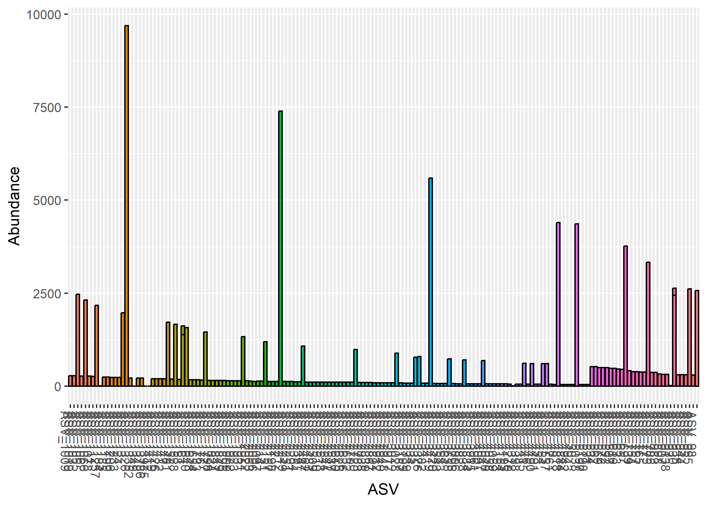
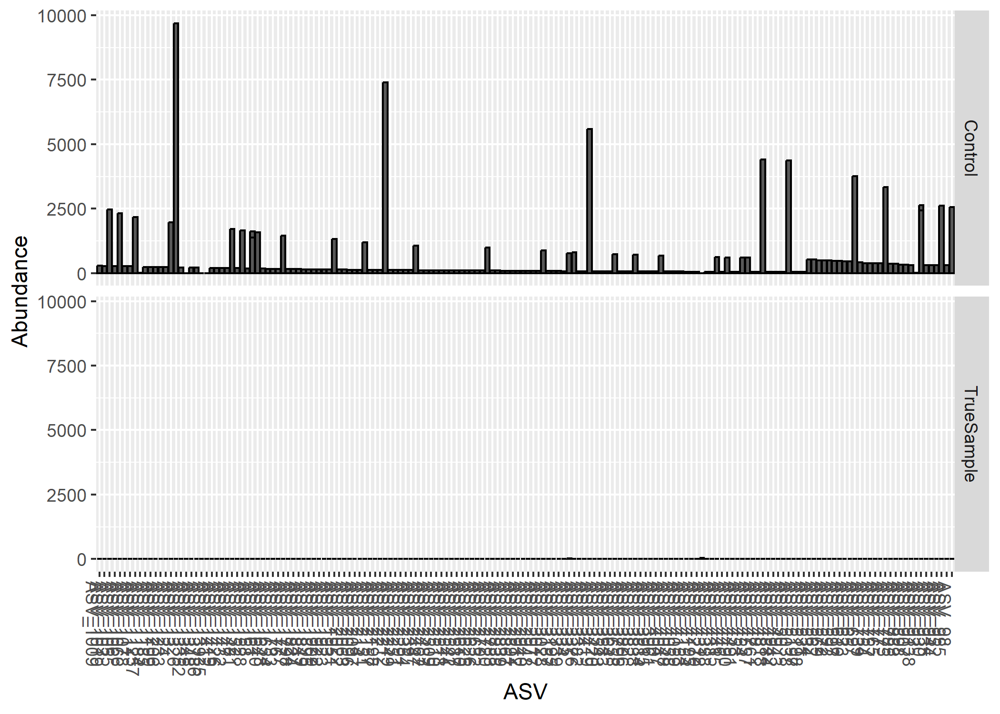
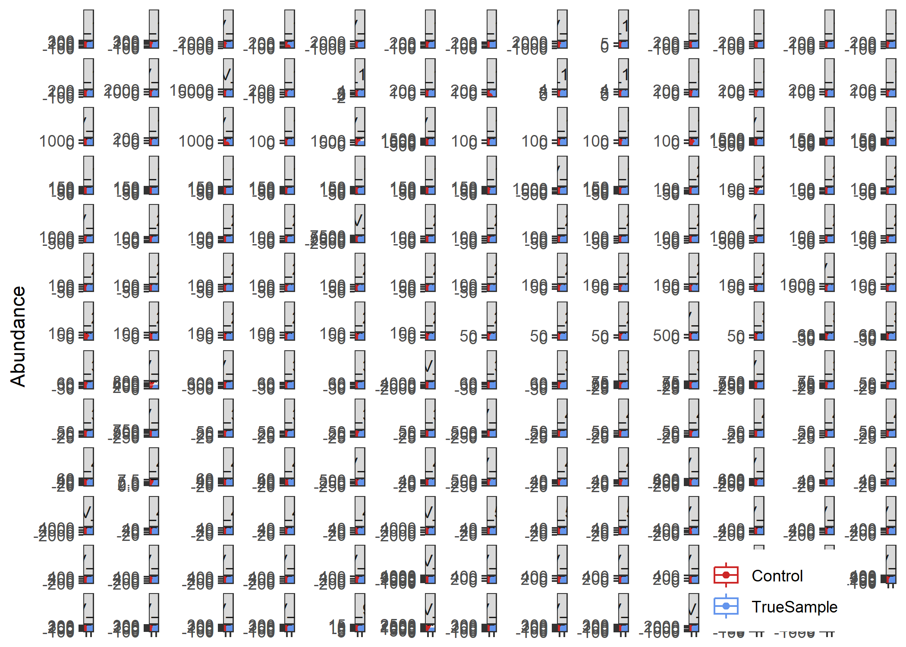

#### Purpose of this file  

This file contains all of the code for producing a curated OTU table from the 16S microbial sequence data for the Armstrong et al. manuscript entitled **"XXX"**, published by [XXX](https://doi.org/10.1093/femsec/fiaa02-AAC-9).

Here, we will process the data into a phyloseq object.

    ASV table
    Taxonomy Table
    Track Reads (metadata)

Then, we will remove the following:

    Remove Chloroplasts
    Remove Mitochondria.
    Removing ASVs from negative controls and also negative control samples.
    Evaluate accuracy by looking at the Mock Community.
    Remove samples without “enough” reads.

Finally, write data file of phyloseq output, which will be stored in Data/02-AAC--PreProcessing/phyloseq_raw_prepro.RData.

##### If you have any questions, you are welcome to email the corresponding author at eja98@cornell.edu or tweet him at [EricJ_Armstrong](https://x.com/EricJ_Armstrong).

Useful links:
https://r-from-a-learners-perspective.readthedocs.io/en/latest/part5/

# 1 - Prepare Workspace
Load necessary R packages and set default parameters

## 1.1 - Define Paths

``` r
# a - Define the main project directory ----
  dir_proj <- 
  "C:/Users/uax75/OneDrive/Documents/R/AAC-BIOcean5D-Coral_Microbiome/"

# b - Define the directory containing the input data ----
  dir_in <- 
  "C:/Users/uax75/OneDrive/Documents/R/AAC-BIOcean5D-Coral_Microbiome/Data/"
    
# c - Define the directories that will contain output Files/Figures/Tables ----
  dir_out_dat <- paste(dir_in,
                       "02-AAC-PreProcessing/", sep = "")
  dir.create(dir_out_dat, recursive = TRUE)
  dir_out_fig <- paste(dir_proj,
                       "Figures/02-AAC-PreProcessing/", sep = "")
  dir.create(dir_out_fig, recursive = TRUE)
  dir_out_tab <- paste(dir_proj,
                       "Tables/02-AAC-PreProcessing/", sep = "")
  dir.create(dir_out_tab, recursive = TRUE)
    
```

## 1.2 - Set Defaults

``` r
# a - Define the output prefix for generated files ----
  pref_out <- "02-AAC-PreProcessing_"
    
# b - Set the random seed value ----
  set.seed(123)

```

## 1.3 - Load Libraries

``` r
# a - load necessary packages ----
  pacman::p_load(devtools, phyloseq, dada2, patchwork, xlsx, BiMiCo,
                 Biostrings, tidyverse, ggpubr, rstatix, ggplot2, expss,
                 install = FALSE)

```


# 2 - Import Data
Load the necessary input data

## 2.1 - Load Phyloseq Data

``` r
# a - First, load the phyloseq object ----
  load(paste(dir_in,
             "01-AAC-AssignSeqVariants/",
             "01-AAC-AssignSeqVariants_physeq_raw.RData",
             sep = ""))

# b - Ceate a sample metadata table --------
  # Load the sample metadata table
  metadata <- read.xlsx(file = paste(dir_in,
                                     "01-AAC-AssignSeqVariants/",
                                     "Master_SampleKey.xlsx", sep = ""),
                        sheetName = "RData")

  # Extract the sample names from the physeq object to match to metadata
  sample.names <- colnames(otu_table(physeq_raw))
  
  # Reorganize the metadata table with the relevant data for the analysis
  samdf <- data.frame("Group" = vlookup(lookup_value = sample.names,
                                       dict = metadata,
                                       lookup_column = "FileName",
                                       result_column = "Group"),
                      "Site" = vlookup(lookup_value = sample.names,
                                       dict = metadata,
                                       lookup_column = "FileName",
                                       result_column = "Site"),
                      "Type" = vlookup(lookup_value = sample.names,
                                       dict = metadata,
                                       lookup_column = "FileName",
                                       result_column = "Type"),
                      "Subtype" = vlookup(lookup_value = sample.names,
                                       dict = metadata,
                                       lookup_column = "FileName",
                                       result_column = "Subtype"),
                      "Transplant" = vlookup(lookup_value = sample.names,
                                       dict = metadata,
                                       lookup_column = "FileName",
                                       result_column = "Transplant"),
                      "Treatment" = vlookup(lookup_value = sample.names,
                                       dict = metadata,
                                       lookup_column = "FileName",
                                       result_column = "Treatment"),
                      "Colony" = vlookup(lookup_value = sample.names,
                                       dict = metadata,
                                       lookup_column = "FileName",
                                       result_column = "Colony"),
                      "Host" = vlookup(lookup_value = sample.names,
                                       dict = metadata,
                                       lookup_column = "FileName",
                                       result_column = "Species"))
  									 
  head(samdf)
#>        Group    Site  Type   Subtype      Transplant Treatment Colony Host
#> 1 TrueSample Tiahura Coral Coral POC        Genotype  Genotype    C01  POC
#> 2 TrueSample Opunohu Coral Coral POC        Genotype  Genotype    C05  POC
#> 3 TrueSample Tiahura Coral Coral POC Back Transplant    Pre-HS    C01  POC
#> 4 TrueSample Tiahura Coral Coral POC Back Transplant    Pre-HS    C02  POC
#> 5 TrueSample Tiahura Coral Coral POC Back Transplant    Pre-HS    C03  POC
#> 6 TrueSample Tiahura Coral Coral POC Back Transplant    Pre-HS    C04  POC
  row.names(samdf) <- sample.names

# d - Append the sample metadata to the Phyloseq object ----
  sample_data(physeq_raw) <- samdf
  
  # Turn the 'treatment' column into a character vector and reorder
  sample_data(physeq_raw)$Treatment <-
    as.character(sample_data(physeq_raw)$Treatment)
  
  sample_data(physeq_raw)$Treatment <- 
    factor(sample_data(physeq_raw)$Treatment,
           levels=c("Genotype", "2-Weeks",
                    "4-Months", "Pre-HS", "Post-HS", NA))
  
  # Add a column with the SampleID names to the Phyloseq object
  sample_data(physeq_raw)['SampleID'] <- row.names(sample_data(physeq_raw)) 

```

# 3 - Data Cleanup
## 3.1 - Remove Organelle Sequences

``` r
# a - Remove Chloroplast Sequences ----

  # Make a new physeq without chloroplasts
    physeq_noChloros <-
      physeq_raw %>%
      # rm chloroplasts
      subset_taxa(Order != "Chloroplast" | is.na(Order))
  
  # How many taxa were chloroplasts? 
    num_chloro_ASVs <- ntaxa(physeq_raw) - ntaxa(physeq_noChloros)
    num_chloro_ASVs
#> [1] 510
    
# b - Remove Mitochondrial Sequences ---- 
    
  # Make a new physeq without chloroplasts
    physeq_noChlorosMitos <- 
      physeq_noChloros %>%
      subset_taxa(Family != "Mitochondria" | is.na(Family))
    
    # How many mitochondrial ASVs? 
      num_mito_ASVs <- ntaxa(physeq_noChloros) - ntaxa(physeq_noChlorosMitos)
      num_mito_ASVs
#> [1] 98
 
# c - Total number of ASVs removed from chloros and mitos 
  ntaxa(physeq_raw) - ntaxa(physeq_noChlorosMitos)
#> [1] 608
  
# d - Proportion of ASVs kept? 
  ntaxa(physeq_noChlorosMitos)/ntaxa(physeq_raw)
#> [1] 0.9596469
```

## 3.2 - Evaulate & Remove Controls
Take a look at the negative controls and then make a decision about whether or not to remove the ASVs that were found in them

    Negative controls
    ASVs found within the negative controls and their distribution in the samples.
    Evaluate the mock community


``` r
# a - Create a vector of samples that were negative controls --
  samples_control <- 
  rownames(subset(sample_data(physeq_raw), 
                   Subtype %in% 
                     c("PCR Blank", "Extraction Blank", "Field Blank")))

# b - Make a new phyloseq object of only the control samples ----
  physeq_control <- 
    physeq_noChlorosMitos %>%
    prune_samples(
      (sample_names(physeq_noChlorosMitos) %in% samples_control), .) %>%
    #subset_samples(., names %in% samples_control) %>%
    # force remove ASVs with 0 counts 
    prune_taxa(taxa_sums(.) > 0, .)

  physeq_control
#> phyloseq-class experiment-level object
#> otu_table()   OTU Table:         [ 168 taxa and 4 samples ]
#> sample_data() Sample Data:       [ 4 samples by 9 sample variables ]
#> tax_table()   Taxonomy Table:    [ 168 taxa by 10 taxonomic ranks ]
#> refseq()      DNAStringSet:      [ 168 reference sequences ]
  
# c - Vector of control ASVs ----
  ASVs_control <- 
    physeq_control %>%
    tax_table() %>%
    data.frame() %>%
    # rownames_to_column(var = "ASV") %>%
    dplyr::select(ASV) %>%
    as.vector()

# d - Visualize raw abundance values of control ASVs ----
  # physeq_control %>%
  #   plot_bar(., "ASV", fill = "ASV")
  plot_bar(physeq_control, "ASV", fill = "ASV") +
    theme(legend.position = "none")
```



``` r
  
# e - Use vector to subset from larger dataset ---- 
  physeq_neg_controlASV <- 
    physeq_noChlorosMitos %>%
    subset_taxa(., ASV %in% ASVs_control$ASV) %>%
    # we will also need to remove the positive controls from the samples! 
    # We will evaluate the Mock community a bit later on. :) 
    subset_samples(., Subtype != "ZymoMock")
  
  physeq_neg_controlASV
#> phyloseq-class experiment-level object
#> otu_table()   OTU Table:         [ 168 taxa and 157 samples ]
#> sample_data() Sample Data:       [ 157 samples by 9 sample variables ]
#> tax_table()   Taxonomy Table:    [ 168 taxa by 10 taxonomic ranks ]
#> refseq()      DNAStringSet:      [ 168 reference sequences ]
  
# f - Plot Abundances of neg control ASVs in samples versus controls ----
  plot_bar(physeq_neg_controlASV, "ASV", facet_grid = Group~.) +
    theme(legend.position = "none")
```



``` r
  
# g - Calculate the phylum relative abundance 
  # Note: The read depth MUST be normalized in some way: scale_reads
  asv_negControls_df <- 
    physeq_neg_controlASV %>%
    # agglomerate at the ASV level 
    tax_glom(taxrank = "ASV") %>% 
    # Melt to a long format 
    psmelt()
  
  # Set levels of Group variable so that "Control" comes first
  asv_negControls_df$Group <- factor(asv_negControls_df$Group, 
                                     levels = c("Control", "TrueSample"))
  
  # Check
  head(asv_negControls_df)
#>         OTU                       Sample Abundance   Group Site    Type
#> 2402  ASV13        NC2-NegControlSoilKit      9692 Control <NA> Control
#> 8845  ASV22        NC2-NegControlSoilKit      7397 Control <NA> Control
#> 15225 ASV34                        60-NC      5592 Control <NA> Control
#> 20552 ASV48 NC3-NegControlExtractionKit2      4399 Control <NA> Control
#> 21241 ASV50                        60-NC      4364 Control <NA> Control
#> 23290 ASV65                        60-NC      3762 Control <NA> Control
#>                Subtype Transplant Treatment Colony Host
#> 2402  Extraction Blank       <NA>      <NA>   <NA> <NA>
#> 8845  Extraction Blank       <NA>      <NA>   <NA> <NA>
#> 15225      Field Blank       <NA>      <NA>   <NA> <NA>
#> 20552 Extraction Blank       <NA>      <NA>   <NA> <NA>
#> 21241      Field Blank       <NA>      <NA>   <NA> <NA>
#> 23290      Field Blank       <NA>      <NA>   <NA> <NA>
#>                           SampleID  Kingdom          Phylum               Class
#> 2402         NC2-NegControlSoilKit Bacteria  Actinomycetota      Actinobacteria
#> 8845         NC2-NegControlSoilKit Bacteria       Bacillota             Bacilli
#> 15225                        60-NC Bacteria  Pseudomonadota Alphaproteobacteria
#> 20552 NC3-NegControlExtractionKit2 Bacteria  Pseudomonadota Alphaproteobacteria
#> 21241                        60-NC Bacteria    Bacteroidota         Bacteroidia
#> 23290                        60-NC Bacteria Acidobacteriota      Acidobacteriae
#>                     Order               Family             Genus Species
#> 2402  Propionibacteriales Propionibacteriaceae     Cutibacterium    <NA>
#> 8845     Staphylococcales    Staphylococcaceae    Staphylococcus  aureus
#> 15225       Reyranellales       Reyranellaceae        Reyranella    <NA>
#> 20552    Sphingomonadales    Sphingomonadaceae       Sphingobium amiense
#> 21241     Chitinophagales     Chitinophagaceae Sediminibacterium    <NA>
#> 23290          Subgroup 2                 <NA>              <NA>    <NA>
#>       Subspecies    ASV
#> 2402        <NA> ASV_13
#> 8845        <NA> ASV_22
#> 15225       <NA> ASV_34
#> 20552       <NA> ASV_48
#> 21241  salmoneum ASV_50
#> 23290       <NA> ASV_65
  
# h - Statistically test! 
  library(rstatix)
  negControl_ASV_statTest <- 
    asv_negControls_df %>%
    group_by(ASV) %>%
    wilcox_test(Abundance ~ Group) %>%
    # Add the x and y positions for plotting 
    adjust_pvalue(method = "fdr") %>%
    # Make the significance values be stars for plotting
    add_significance() %>%
    # Calculate where to place it on the facet grid plot
    add_xy_position(x = "Group", fun = "max", scales = "free") %>%
    # bring the pvalues a lil lower
    mutate(y.position = y.position * 0.82)
  
  ## Using ggpubr 
  ggboxplot(
    asv_negControls_df, 
    x = "Group", y = "Abundance", 
    color = "Group",
    facet.by = "ASV", scales = "free_y",add = "jitter") + 
    stat_pvalue_manual(negControl_ASV_statTest) + 
    scale_color_manual(values = c("firebrick3", "cornflowerblue")) + 
    scale_fill_manual(values = c("firebrick3", "cornflowerblue")) + 
    theme_bw() + 
    theme(axis.text.x = element_blank(), axis.title.x = element_blank(),
          legend.title = element_blank(), legend.position = c(0.85, 0.07))
```



``` r
  
# i - Remove Control Taxa & Make my new phloseq object ---- 

  physeq_noControlsChlorosMitos <- 
    physeq_noChlorosMitos %>%
    # Actually remove the control ASVs (except 18, 56)
    subset_taxa(., !(ASV %in% ASVs_control))  %>%
    # Remove control samples 
    subset_samples(., !(Subtype %in% 
                          c("PCR Blank", "Extraction Blank", "Field Blank")))

  
# j - save processed physeq object ----
  save(physeq_noControlsChlorosMitos,
         file = paste(dir_out_dat,
                      pref_out,
                      "physeq_noControlsChlorosMitos.RData", sep = ""))
```

# Final info for Reproducibility
Check Render Time

``` r
# Take the time now that we are at the end of the script
end_time <- Sys.time()
end_time 
#> [1] "2026-05-15 10:35:22 EDT"

# Echo the elapsed time
elapsed_time <- round((end_time - start_time), 3)
elapsed_time
#> Time difference of 47.168 secs
```

# Session Information

``` r
# Ensure reproducibility with package version information
devtools::session_info()
#> ─ Session info ───────────────────────────────────────────────────────────────
#>  setting  value
#>  version  R version 4.5.1 (2025-06-13 ucrt)
#>  os       Windows 11 x64 (build 26200)
#>  system   x86_64, mingw32
#>  ui       RTerm
#>  language (EN)
#>  collate  English_United States.utf8
#>  ctype    English_United States.utf8
#>  tz       America/New_York
#>  date     2026-05-15
#>  pandoc   3.6.3 @ C:/Program Files/RStudio/resources/app/bin/quarto/bin/tools/ (via rmarkdown)
#>  quarto   NA @ C:\\PROGRA~1\\RStudio\\RESOUR~1\\app\\bin\\quarto\\bin\\quarto.exe
#> 
#> ─ Packages ───────────────────────────────────────────────────────────────────
#>  ! package              * version  date (UTC) lib source
#>    abind                  1.4-8    2024-09-12 [1] CRAN (R 4.5.0)
#>    ade4                   1.7-23   2025-02-14 [1] CRAN (R 4.5.1)
#>    ape                    5.8-1    2024-12-16 [1] CRAN (R 4.5.1)
#>    backports              1.5.0    2024-05-23 [1] CRAN (R 4.5.0)
#>    BiMiCo               * 0.1.0    2025-12-11 [1] Github (peterolah001/BiMiCo@01a80b4)
#>    Biobase                2.69.0   2025-06-04 [1] Bioconductor 3.22 (R 4.5.0)
#>    BiocGenerics         * 0.55.1   2025-07-28 [1] Bioconductor 3.22 (R 4.5.1)
#>    BiocParallel           1.43.4   2025-06-16 [1] Bioconductor 3.22 (R 4.5.0)
#>    biomformat             1.37.0   2025-06-04 [1] Bioconductor 3.22 (R 4.5.0)
#>    Biostrings           * 2.77.2   2025-06-22 [1] Bioconductor 3.22 (R 4.5.1)
#>    bitops                 1.0-9    2024-10-03 [1] CRAN (R 4.5.0)
#>    broom                  1.0.11   2025-12-04 [1] CRAN (R 4.5.2)
#>    bslib                  0.9.0    2025-01-30 [1] CRAN (R 4.5.1)
#>    cachem                 1.1.0    2024-05-16 [1] CRAN (R 4.5.1)
#>    car                    3.1-3    2024-09-27 [1] CRAN (R 4.5.1)
#>    carData                3.0-5    2022-01-06 [1] CRAN (R 4.5.1)
#>    checkmate              2.3.3    2025-08-18 [1] CRAN (R 4.5.1)
#>    cli                    3.6.5    2025-04-23 [1] CRAN (R 4.5.1)
#>    cluster                2.1.8.1  2025-03-12 [2] CRAN (R 4.5.1)
#>    codetools              0.2-20   2024-03-31 [2] CRAN (R 4.5.1)
#>    crayon                 1.5.3    2024-06-20 [1] CRAN (R 4.5.1)
#>    dada2                * 1.37.0   2025-06-04 [1] Bioconductor 3.22 (R 4.5.0)
#>    data.table             1.17.8   2025-07-10 [1] CRAN (R 4.5.1)
#>    DelayedArray           0.35.3   2025-09-14 [1] Bioconductor 3.22 (R 4.5.1)
#>    deldir                 2.0-4    2024-02-28 [1] CRAN (R 4.5.0)
#>    devtools             * 2.4.6    2025-10-03 [1] CRAN (R 4.5.2)
#>    dichromat              2.0-0.1  2022-05-02 [1] CRAN (R 4.5.0)
#>    digest                 0.6.37   2024-08-19 [1] CRAN (R 4.5.1)
#>    dplyr                * 1.1.4    2023-11-17 [1] CRAN (R 4.5.1)
#>    ellipsis               0.3.2    2021-04-29 [1] CRAN (R 4.5.1)
#>    evaluate               1.0.5    2025-08-27 [1] CRAN (R 4.5.1)
#>    expss                * 0.11.6   2023-07-15 [1] CRAN (R 4.5.1)
#>    farver                 2.1.2    2024-05-13 [1] CRAN (R 4.5.1)
#>    fastmap                1.2.0    2024-05-15 [1] CRAN (R 4.5.1)
#>    forcats              * 1.0.0    2023-01-29 [1] CRAN (R 4.5.1)
#>    foreach                1.5.2    2022-02-02 [1] CRAN (R 4.5.1)
#>    Formula                1.2-5    2023-02-24 [1] CRAN (R 4.5.0)
#>    fs                     1.6.6    2025-04-12 [1] CRAN (R 4.5.1)
#>    generics             * 0.1.4    2025-05-09 [1] CRAN (R 4.5.1)
#>    GenomicAlignments      1.45.4   2025-09-14 [1] Bioconductor 3.22 (R 4.5.1)
#>    GenomicRanges          1.61.3   2025-09-14 [1] Bioconductor 3.22 (R 4.5.1)
#>    ggplot2              * 4.0.1    2025-11-14 [1] CRAN (R 4.5.2)
#>    ggpubr               * 0.6.2    2025-10-17 [1] CRAN (R 4.5.2)
#>    ggsignif               0.6.4    2022-10-13 [1] CRAN (R 4.5.1)
#>    glue                   1.8.0    2024-09-30 [1] CRAN (R 4.5.1)
#>    gtable                 0.3.6    2024-10-25 [1] CRAN (R 4.5.1)
#>    hms                    1.1.4    2025-10-17 [1] CRAN (R 4.5.2)
#>    htmlTable              2.4.3    2024-07-21 [1] CRAN (R 4.5.1)
#>    htmltools              0.5.8.1  2024-04-04 [1] CRAN (R 4.5.1)
#>    htmlwidgets            1.6.4    2023-12-06 [1] CRAN (R 4.5.1)
#>    hwriter                1.3.2.1  2022-04-08 [1] CRAN (R 4.5.0)
#>    igraph                 2.1.4    2025-01-23 [1] CRAN (R 4.5.1)
#>    interp                 1.1-6    2024-01-26 [1] CRAN (R 4.5.1)
#>    IRanges              * 2.43.0   2025-06-04 [1] Bioconductor 3.22 (R 4.5.0)
#>    iterators              1.0.14   2022-02-05 [1] CRAN (R 4.5.1)
#>    jpeg                   0.1-11   2025-03-21 [1] CRAN (R 4.5.0)
#>    jquerylib              0.1.4    2021-04-26 [1] CRAN (R 4.5.1)
#>    jsonlite               2.0.0    2025-03-27 [1] CRAN (R 4.5.1)
#>    knitr                  1.50     2025-03-16 [1] CRAN (R 4.5.1)
#>    labeling               0.4.3    2023-08-29 [1] CRAN (R 4.5.0)
#>    lattice                0.22-7   2025-04-02 [2] CRAN (R 4.5.1)
#>    latticeExtra           0.6-31   2025-09-10 [1] CRAN (R 4.5.1)
#>    lifecycle              1.0.5    2026-01-08 [1] CRAN (R 4.5.1)
#>    lubridate            * 1.9.4    2024-12-08 [1] CRAN (R 4.5.1)
#>    maditr               * 0.8.6    2025-08-30 [1] CRAN (R 4.5.1)
#>    magrittr               2.0.3    2022-03-30 [1] CRAN (R 4.5.1)
#>    MASS                   7.3-65   2025-02-28 [2] CRAN (R 4.5.1)
#>    Matrix                 1.7-3    2025-03-11 [2] CRAN (R 4.5.1)
#>    MatrixGenerics         1.21.0   2025-06-04 [1] Bioconductor 3.22 (R 4.5.0)
#>    matrixStats            1.5.0    2025-01-07 [1] CRAN (R 4.5.1)
#>    memoise                2.0.1    2021-11-26 [1] CRAN (R 4.5.1)
#>    mgcv                   1.9-3    2025-04-04 [2] CRAN (R 4.5.1)
#>    multtest               2.65.0   2025-06-04 [1] Bioconductor 3.22 (R 4.5.0)
#>    nlme                   3.1-168  2025-03-31 [2] CRAN (R 4.5.1)
#>    pacman                 0.5.1    2019-03-11 [1] CRAN (R 4.5.2)
#>    patchwork            * 1.3.2    2025-08-25 [1] CRAN (R 4.5.1)
#>    permute                0.9-8    2025-06-25 [1] CRAN (R 4.5.1)
#>    phyloseq             * 1.53.0   2025-06-04 [1] Bioconductor 3.22 (R 4.5.0)
#>    pillar                 1.11.1   2025-09-17 [1] CRAN (R 4.5.1)
#>    pkgbuild               1.4.8    2025-05-26 [1] CRAN (R 4.5.1)
#>    pkgconfig              2.0.3    2019-09-22 [1] CRAN (R 4.5.1)
#>    pkgload                1.4.1    2025-09-23 [1] CRAN (R 4.5.2)
#>    plyr                   1.8.9    2023-10-02 [1] CRAN (R 4.5.1)
#>    png                    0.1-8    2022-11-29 [1] CRAN (R 4.5.0)
#>    purrr                * 1.1.0    2025-07-10 [1] CRAN (R 4.5.1)
#>    pwalign                1.5.0    2025-06-04 [1] Bioconductor 3.22 (R 4.5.0)
#>    R6                     2.6.1    2025-02-15 [1] CRAN (R 4.5.1)
#>    RColorBrewer           1.1-3    2022-04-03 [1] CRAN (R 4.5.0)
#>    Rcpp                 * 1.1.0    2025-07-02 [1] CRAN (R 4.5.1)
#>  D RcppParallel           5.1.11-1 2025-08-27 [1] CRAN (R 4.5.1)
#>    readr                * 2.1.5    2024-01-10 [1] CRAN (R 4.5.1)
#>    remotes                2.5.0    2024-03-17 [1] CRAN (R 4.5.2)
#>    reshape2               1.4.4    2020-04-09 [1] CRAN (R 4.5.1)
#>    rhdf5                  2.53.4   2025-08-06 [1] Bioconductor 3.22 (R 4.5.1)
#>  D rhdf5filters           1.21.0   2025-06-04 [1] Bioconductor 3.22 (R 4.5.0)
#>    Rhdf5lib               1.31.0   2025-06-04 [1] Bioconductor 3.22 (R 4.5.0)
#>  D rJava                  1.0-11   2024-01-26 [1] CRAN (R 4.5.0)
#>    rlang                  1.1.6    2025-04-11 [1] CRAN (R 4.5.1)
#>    rmarkdown              2.30     2025-09-28 [1] CRAN (R 4.5.2)
#>    Rsamtools              2.25.3   2025-09-03 [1] Bioconductor 3.22 (R 4.5.1)
#>    rstatix              * 0.7.3    2025-10-18 [1] CRAN (R 4.5.2)
#>    rstudioapi             0.17.1   2024-10-22 [1] CRAN (R 4.5.1)
#>    S4Arrays               1.9.1    2025-06-04 [1] Bioconductor 3.22 (R 4.5.0)
#>    S4Vectors            * 0.47.0   2025-06-04 [1] Bioconductor 3.22 (R 4.5.0)
#>    S7                     0.2.0    2024-11-07 [1] CRAN (R 4.5.1)
#>    sass                   0.4.10   2025-04-11 [1] CRAN (R 4.5.1)
#>    scales                 1.4.0    2025-04-24 [1] CRAN (R 4.5.1)
#>    Seqinfo              * 0.99.2   2025-07-22 [1] Bioconductor 3.22 (R 4.5.1)
#>    sessioninfo            1.2.3    2025-02-05 [1] CRAN (R 4.5.1)
#>    ShortRead              1.67.1   2025-07-25 [1] Bioconductor 3.22 (R 4.5.1)
#>    SparseArray            1.9.1    2025-07-18 [1] Bioconductor 3.22 (R 4.5.1)
#>    stringi                1.8.7    2025-03-27 [1] CRAN (R 4.5.0)
#>    stringr              * 1.6.0    2025-11-04 [1] CRAN (R 4.5.2)
#>    SummarizedExperiment   1.39.1   2025-06-22 [1] Bioconductor 3.22 (R 4.5.1)
#>    survival               3.8-3    2024-12-17 [2] CRAN (R 4.5.1)
#>    tibble               * 3.3.0    2025-06-08 [1] CRAN (R 4.5.1)
#>    tidyr                * 1.3.1    2024-01-24 [1] CRAN (R 4.5.1)
#>    tidyselect             1.2.1    2024-03-11 [1] CRAN (R 4.5.1)
#>    tidyverse            * 2.0.0    2023-02-22 [1] CRAN (R 4.5.1)
#>    timechange             0.3.0    2024-01-18 [1] CRAN (R 4.5.1)
#>    tzdb                   0.5.0    2025-03-15 [1] CRAN (R 4.5.1)
#>    usethis              * 3.2.1    2025-09-06 [1] CRAN (R 4.5.1)
#>    vctrs                  0.6.5    2023-12-01 [1] CRAN (R 4.5.1)
#>    vegan                  2.7-1    2025-06-05 [1] CRAN (R 4.5.1)
#>    withr                  3.0.2    2024-10-28 [1] CRAN (R 4.5.1)
#>    xfun                   0.53     2025-08-19 [1] CRAN (R 4.5.1)
#>    xlsx                 * 0.6.5    2020-11-10 [1] CRAN (R 4.5.0)
#>    xlsxjars               0.9.0    2025-07-02 [1] CRAN (R 4.5.1)
#>    XVector              * 0.49.0   2025-06-04 [1] Bioconductor 3.22 (R 4.5.0)
#>    yaml                   2.3.10   2024-07-26 [1] CRAN (R 4.5.0)
#> 
#>  [1] C:/Users/uax75/AppData/Local/R/win-library/4.5
#>  [2] C:/Program Files/R/R-4.5.1/library
#> 
#>  * ── Packages attached to the search path.
#>  D ── DLL MD5 mismatch, broken installation.
#> 
#> ──────────────────────────────────────────────────────────────────────────────
```

