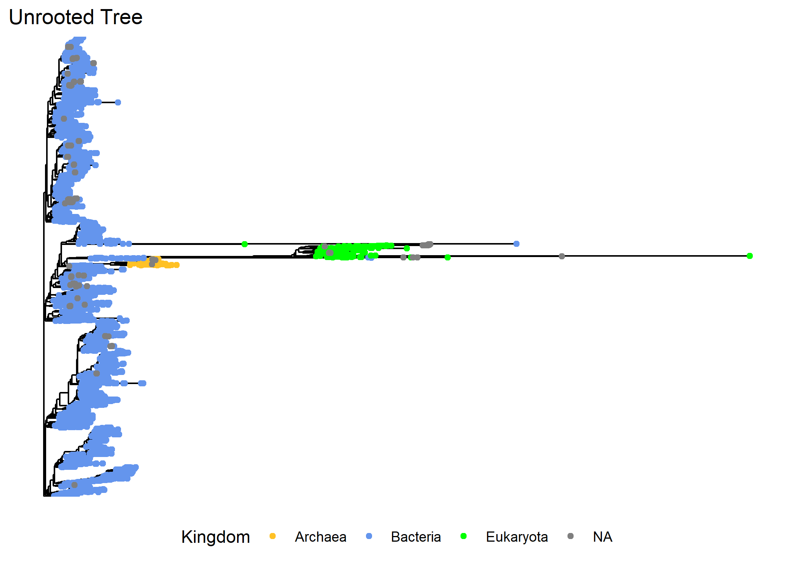
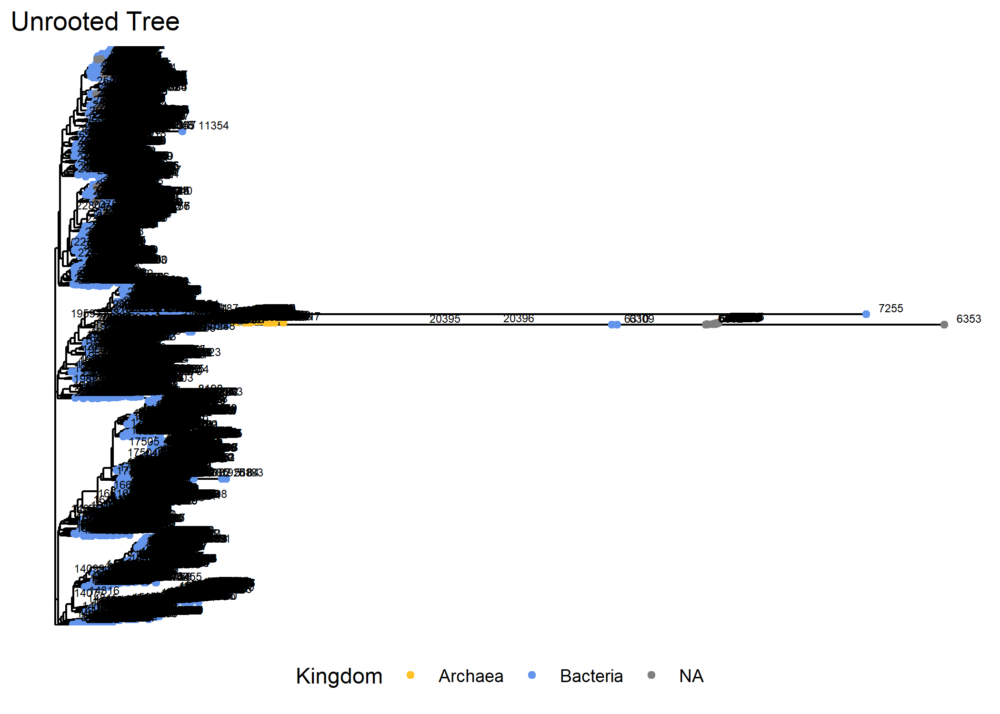

#### Purpose of this file  

This file contains all of the code for producing a curated OTU table from the 16S microbial sequence data for the Armstrong et al. manuscript entitled **"XXX"**, published by [XXX](https://doi.org/10.1093/femsec/fiaa029).

##### If you have any questions, you are welcome to email the corresponding author at eja98@cornell.edu or tweet him at [EricJ_Armstrong](https://x.com/EricJ_Armstrong).

The goal is to create a phylogenetic tree

1.  Load in preprocessed phyloseq object.
2.  Create ASV fasta file from the phyloseq object.
3.  Align the 16S sequences from fasta file with MAFFT.
4.  Create a tree with FastTree2.

Finally, write data file of phyloseq output, which will be stored in Data/03-AAC-PhylogeneticTree/.

##### If you have any questions, you are welcome to email the corresponding author at eja98@cornell.edu or tweet him at [EricJ_Armstrong](https://x.com/EricJ_Armstrong).

# 1 - Prepare Workspace
Load necessary R packages and set default parameters

## 1.1 - Define Paths

``` r
# a - Define the main project directory ----
  dir_proj <- "C:/Users/uax75/OneDrive/Documents/R/AAC-BIOcean5D-Coral_Microbiome/"

# b - Define the directory containing the input data ----
  dir_in <- "C:/Users/uax75/OneDrive/Documents/R/AAC-BIOcean5D-Coral_Microbiome/Data/"
    
# c - Define the directories that will contain output Files/Figures/Tables ----
  dir_out_dat <- 
    "C:/Users/uax75/OneDrive/Documents/R/AAC-BIOcean5D-Coral_Microbiome/Data/03-AAC-PhylogeneticTree/"
  dir.create(dir_out_dat, recursive = TRUE)
  dir_out_fig <- 
    "C:/Users/uax75/OneDrive/Documents/R/AAC-BIOcean5D-Coral_Microbiome/Figures/03-AAC-PhylogeneticTree/"
  dir.create(dir_out_fig, recursive = TRUE)
  dir_out_tab <- 
    "C:/Users/uax75/OneDrive/Documents/R/AAC-BIOcean5D-Coral_Microbiome/Tables/03-AAC-PhylogeneticTree/"
  dir.create(dir_out_tab, recursive = TRUE)
```

## 1.2 - Set Defaults

``` r
# a - Define the output prefix for generated files ----
  pref_out <- "03-AAC-PhylogeneticTree_"
    
# b - Set the random seed value ----
  set.seed(123)

```

## 1.3 - Load Libraries

``` r
# a - load necessary packages ----
  pacman::p_load(tidyverse, phyloseq, ggtree, phytools, ggplot2, expss,
                 install = FALSE)

```

## 1.4 - Load Phyloseq Object


``` r
# a - Load physeq ----
  load(paste(dir_in,
             "02-AAC-PreProcessing/",
             "02-AAC-PreProcessing_physeq_noControlsChlorosMitos.RData",
             sep = ""))
```


# 2 - Create Fasta File of ASV and their Sequences

This fasta file will be used to create our alignment in MAFFT


``` r
# a - pull out ASV seqs and ASV names ----
  df_asv_seq <- 
    physeq_noControlsChlorosMitos@refseq %>%
    data.frame() %>%
    rownames_to_column(var = "ASV") %>%
    rename(RefSeq = 2)

# b - Add the > to make fasta header ----
  df_asv_seq$ASV <- paste0(">",df_asv_seq$ASV)
  #View(asv_seq_df)

# c - Create the fasta object ----
  fasta_asv_seq <- c(rbind(df_asv_seq$ASV, df_asv_seq$RefSeq))
  head(fasta_asv_seq)
#> [1] ">ASV1"                                                                                                                                                                                                                  
#> [2] "TACGGAGGGTGCGAGCGTTAATCGGAATTACTGGGCGTAAAGCGTGCGTAGGCGGCTTTTTAAGTTGGATGTGAAAGCCCCGGGCTCAACCTGGGAACTGCATCCAAAACTGGAAGGCTCGAGTGCGAGAGAGGAGTGTGGAATTTCCTGTGTAGCGGTGAAATGCGTAGATATAGGAAGGAACACCAGTGGCGAAGGCGACACTCTGGCTTGAC"
#> [3] ">ASV2"                                                                                                                                                                                                                  
#> [4] "TACGGAGGATGCAAGCGTTATCCGGAATTATTGGGCGTAAAGCGTCCGCAGGCGGCACTATAAGTCTGCTGTCAAAGACCGCAGCTCAACTGCGGAAAGGCAGTGGAAACTGTAGAGCTAGAGTATGGTAGGGGTAGAGGGAATTCCCAGTGTAGCGGTGAAATGCGTAGAGATTGGGAAGAACACCAGTGGCGAAAGCGCTCTACTGGGCCAT" 
#> [5] ">ASV4"                                                                                                                                                                                                                  
#> [6] "TAATACGGGAGTGGCAAGCGTTATCCGGAATTATTGGGCGTAAAGCGTCCGCAGGCGGCCCTTCAAGTCTGCTGTTAAAAAGTGGAGCTTAACTCCATCATGGCAGTGGAAACTGTTGGGCTTGAGTGTGGTAGGGGCAGAGGGAATTCCCGGTGTAGCGGTGAAATGCGTAGATATCGGGAAGAACACCAGTGGCGAAGGCGCTC"
  
# d - Write to a file ----
  write(fasta_asv_seq, 
        file = paste(dir_out_dat, pref_out,
                     "PhyseqASVs.fasta",
                     sep = ""))
```

# 3 - Align the 16S sequences from fasta file with MAFFT


``` bash
# Write bash code to run mafft
# First provide the path to mafft
export PATH=/programs/mafft/bin:$PATH
# change directories to provide the fasta file we made above
cd /workdir/eja98/BIO5D_Data/Data/03-AAC-PhylogeneticTree/
pwd

# Set a seed  - using same seed as before for consistency
RANDOM=238428

# Run Mafft
# To test in the shell directly from Rmd
# mac: command + option + enter
# Windows: control + alt + enter
# For now, use default options, note the version
# MAFFT automatically knows that it's a nucleotide alignment
/programs/mafft/bin/mafft --auto 03-AAC-PhylogeneticTree_PhyseqASVs.fasta > 03-AAC-PhylogeneticTree_MAFFT_aligned_PhyseqASVs.fasta
```

# 4 - FastTree2


``` bash
# Provide export path to fasttree
export PATH=/programs/FastTree-2.1.11:$PATH

# cd into the alignment file folder
cd /workdir/eja98/BIO5D_Data/Data/03-AAC-PhylogeneticTree/
pwd


FastTree -nt -gtr -fastest -log FastTree.log 03-AAC-PhylogeneticTree_MAFFT_aligned_PhyseqASVs.fasta > 03-AAC-PhylogeneticTree_PhyseqASVs_Unrooted.tree
```

# 5 - Tree Visualizations
# 5.1 - Load in the tree ----

``` r
unrooted_tree <- read.tree(
  paste(dir_in, "03-AAC-PhylogeneticTree/",
        "03-AAC-PhylogeneticTree_PhyseqASVs_Unrooted.tree", sep = ""))
unrooted_tree
#> 
#> Phylogenetic tree with 14459 tips and 14457 internal nodes.
#> 
#> Tip labels:
#>   ASV10084, ASV13616, ASV7921, ASV9771, ASV10287, ASV14635, ...
#> Node labels:
#>   , 0.970, 0.917, 0.255, 0.991, 0.854, ...
#> 
#> Unrooted; includes branch length(s).
```

# 5.2 - Merge tree and phyloseq objects ----

``` r
# Intuition check 
stopifnot(ntaxa(physeq_noControlsChlorosMitos) == ntaxa(unrooted_tree))

# Merge the tree with the phyloseq object 
unrooted_physeq <- 
  merge_phyloseq(physeq_noControlsChlorosMitos, unrooted_tree)
```

# 5.3 - Plot the tree ----

``` r
# Make a basic tree
kingdom_tree <- 
  ggtree(unrooted_physeq) + 
  # color tips by kingdom 
  geom_tippoint(mapping = aes(color = Kingdom)) + 
  scale_color_manual(
    values = c("goldenrod1", "cornflowerblue", "green", "red")) +
  # Add title 
  labs(title = "Unrooted Tree") + 
  #move the legend to the bottom 
  theme(legend.position = "bottom")
kingdom_tree
```



# 5.4 - Prune bad taxa ----

``` r
# Function from Joey McMurdie: https://github.com/joey711/phyloseq/issues/652
pop_taxa = function(physeq, badTaxa){
  allTaxa <-  taxa_names(physeq)
  allTaxa <- allTaxa[!(allTaxa %in% badTaxa)]
  return(prune_taxa(allTaxa, physeq))}

# Let's use the pop_taxa function :) 
# Recreate a phyloseq object without eukaryotic taxa
EukTaxa <- unrooted_physeq %>%
  subset_taxa(., Kingdom %in% "Eukaryota") %>%
  otu_table(.) %>%
  rownames(.)

unrooted_physeq_noEuk_clean <- 
  unrooted_physeq %>%
  pop_taxa(., EukTaxa)

kingdom_tree_noEuk <- 
  ggtree(unrooted_physeq_noEuk_clean) + 
  # color tips by kingdom 
  geom_tippoint(mapping = aes(color = Kingdom)) + 
  scale_color_manual(values = c("goldenrod1", "cornflowerblue", "red")) +
  # Add the node label 
  geom_text(aes(label=node), hjust= -0.5, vjust = -0.3, size = 2) +
  # Add title 
  labs(title = "Unrooted Tree") + 
  #move the legend to the bottom 
  theme(legend.position = "bottom")
kingdom_tree_noEuk
```



``` r

# unrooted_physeq_noEuk %>%
#   subset_taxa(., ASV == "ASV37625") %>%
#   tax_table() %>%
#   data.frame()
# 
# viewClade(kingdom_tree_noEuk + 
#           labs(title = "Unrooted Tree: Node 70365") + 
#           geom_text(aes(label=ASV)), 
#           node = 70366)
# 
# unrooted_physeq %>%
#   subset_taxa(., ASV == "ASV46311") %>%
#   otu_table() %>%
#   data.frame() %>%
#   colSums()
# 
# unrooted_physeq_noEuk_clean <- 
#   unrooted_physeq_noEuk %>%
#   pop_taxa(., c("ASV52526", "ASV16124", "ASV41334", "ASV46311"))
# 
# kingdom_tree_noEuk_clean <- 
#   ggtree(unrooted_physeq_noEuk) + 
#   # color tips by kingdom 
#   geom_tippoint(mapping = aes(color = Kingdom)) + 
#   scale_color_manual(values = c("goldenrod1", "cornflowerblue", "grey")) +
#   # Add the node label 
#   geom_text(aes(label=node), hjust= -0.5, vjust = -0.3, size = 2) +
#   # Add title 
#   labs(title = "Unrooted Tree") + 
#   #move the legend to the bottom 
#   theme(legend.position = "bottom")
# kingdom_tree_noEuk_clean

```

# 5.5 - Root the Tree ----

``` r
# Is the tree rooted?
is.rooted(phy_tree(unrooted_physeq_noEuk_clean))
#> [1] FALSE

# Let's midpoint root the tree
midpoint_rooted_tree <- midpoint.root(phy_tree(unrooted_physeq_noEuk_clean))

# Is the new tree rooted?
is.rooted(midpoint_rooted_tree)
#> [1] TRUE
```

# 5.6 - Create New Phyloseq Object ----

``` r
# Assign to a new phyloseq object: merging subsetted phyloseq with the new rooted tree

# Merge tree with the new unrooted_physeq_noEuk_clean
physeq_midpointTree <- 
  merge_phyloseq(unrooted_physeq_noEuk_clean, midpoint_rooted_tree)

# Save both phyloseq objects with our tree object to one .RData file
save(physeq_midpointTree,
         file = paste(dir_out_dat,
                      pref_out,
                      "physeq_midpointTree.RData", sep = ""))
```

# Session Information

``` r
devtools::session_info()
#> ─ Session info ───────────────────────────────────────────────────────────────
#>  setting  value
#>  version  R version 4.5.1 (2025-06-13 ucrt)
#>  os       Windows 11 x64 (build 26200)
#>  system   x86_64, mingw32
#>  ui       RTerm
#>  language (EN)
#>  collate  English_United States.utf8
#>  ctype    English_United States.utf8
#>  tz       America/New_York
#>  date     2026-05-15
#>  pandoc   3.6.3 @ C:/Program Files/RStudio/resources/app/bin/quarto/bin/tools/ (via rmarkdown)
#>  quarto   NA @ C:\\PROGRA~1\\RStudio\\RESOUR~1\\app\\bin\\quarto\\bin\\quarto.exe
#> 
#> ─ Packages ───────────────────────────────────────────────────────────────────
#>  ! package           * version    date (UTC) lib source
#>    ade4                1.7-23     2025-02-14 [1] CRAN (R 4.5.1)
#>    ape               * 5.8-1      2024-12-16 [1] CRAN (R 4.5.1)
#>    aplot               0.2.9      2025-09-12 [1] CRAN (R 4.5.1)
#>    backports           1.5.0      2024-05-23 [1] CRAN (R 4.5.0)
#>    Biobase             2.69.0     2025-06-04 [1] Bioconductor 3.22 (R 4.5.0)
#>    BiocGenerics        0.55.1     2025-07-28 [1] Bioconductor 3.22 (R 4.5.1)
#>    biomformat          1.37.0     2025-06-04 [1] Bioconductor 3.22 (R 4.5.0)
#>    Biostrings          2.77.2     2025-06-22 [1] Bioconductor 3.22 (R 4.5.1)
#>    bslib               0.9.0      2025-01-30 [1] CRAN (R 4.5.1)
#>    cachem              1.1.0      2024-05-16 [1] CRAN (R 4.5.1)
#>    checkmate           2.3.3      2025-08-18 [1] CRAN (R 4.5.1)
#>    cli                 3.6.5      2025-04-23 [1] CRAN (R 4.5.1)
#>    cluster             2.1.8.1    2025-03-12 [2] CRAN (R 4.5.1)
#>    clusterGeneration   1.3.8      2023-08-16 [1] CRAN (R 4.5.2)
#>    coda                0.19-4.1   2024-01-31 [1] CRAN (R 4.5.1)
#>    codetools           0.2-20     2024-03-31 [2] CRAN (R 4.5.1)
#>    combinat            0.0-8      2012-10-29 [1] CRAN (R 4.5.2)
#>    crayon              1.5.3      2024-06-20 [1] CRAN (R 4.5.1)
#>    data.table          1.17.8     2025-07-10 [1] CRAN (R 4.5.1)
#>    DEoptim             2.2-8      2022-11-11 [1] CRAN (R 4.5.2)
#>    devtools            2.4.6      2025-10-03 [1] CRAN (R 4.5.2)
#>    dichromat           2.0-0.1    2022-05-02 [1] CRAN (R 4.5.0)
#>    digest              0.6.37     2024-08-19 [1] CRAN (R 4.5.1)
#>    doParallel          1.0.17     2022-02-07 [1] CRAN (R 4.5.1)
#>    dplyr             * 1.1.4      2023-11-17 [1] CRAN (R 4.5.1)
#>    ellipsis            0.3.2      2021-04-29 [1] CRAN (R 4.5.1)
#>    evaluate            1.0.5      2025-08-27 [1] CRAN (R 4.5.1)
#>    expm                1.0-0      2024-08-19 [1] CRAN (R 4.5.2)
#>    expss             * 0.11.6     2023-07-15 [1] CRAN (R 4.5.1)
#>    farver              2.1.2      2024-05-13 [1] CRAN (R 4.5.1)
#>    fastmap             1.2.0      2024-05-15 [1] CRAN (R 4.5.1)
#>    fastmatch           1.1-6      2024-12-23 [1] CRAN (R 4.5.0)
#>    forcats           * 1.0.0      2023-01-29 [1] CRAN (R 4.5.1)
#>    foreach             1.5.2      2022-02-02 [1] CRAN (R 4.5.1)
#>    fs                  1.6.6      2025-04-12 [1] CRAN (R 4.5.1)
#>    generics            0.1.4      2025-05-09 [1] CRAN (R 4.5.1)
#>    ggfun               0.2.0      2025-07-15 [1] CRAN (R 4.5.1)
#>    ggiraph             0.9.1      2025-09-16 [1] CRAN (R 4.5.1)
#>    ggplot2           * 4.0.1      2025-11-14 [1] CRAN (R 4.5.2)
#>    ggplotify           0.1.3      2025-09-20 [1] CRAN (R 4.5.1)
#>    ggtree            * 3.99.0     2025-09-17 [1] Bioconductor 3.22 (R 4.5.1)
#>    glue                1.8.0      2024-09-30 [1] CRAN (R 4.5.1)
#>    gridGraphics        0.5-1      2020-12-13 [1] CRAN (R 4.5.1)
#>    gtable              0.3.6      2024-10-25 [1] CRAN (R 4.5.1)
#>    hms                 1.1.4      2025-10-17 [1] CRAN (R 4.5.2)
#>    htmlTable           2.4.3      2024-07-21 [1] CRAN (R 4.5.1)
#>    htmltools           0.5.8.1    2024-04-04 [1] CRAN (R 4.5.1)
#>    htmlwidgets         1.6.4      2023-12-06 [1] CRAN (R 4.5.1)
#>    igraph              2.1.4      2025-01-23 [1] CRAN (R 4.5.1)
#>    IRanges             2.43.0     2025-06-04 [1] Bioconductor 3.22 (R 4.5.0)
#>    iterators           1.0.14     2022-02-05 [1] CRAN (R 4.5.1)
#>    jquerylib           0.1.4      2021-04-26 [1] CRAN (R 4.5.1)
#>    jsonlite            2.0.0      2025-03-27 [1] CRAN (R 4.5.1)
#>    knitr               1.50       2025-03-16 [1] CRAN (R 4.5.1)
#>    labeling            0.4.3      2023-08-29 [1] CRAN (R 4.5.0)
#>    lattice             0.22-7     2025-04-02 [2] CRAN (R 4.5.1)
#>    lazyeval            0.2.2      2019-03-15 [1] CRAN (R 4.5.1)
#>    lifecycle           1.0.5      2026-01-08 [1] CRAN (R 4.5.1)
#>    lubridate         * 1.9.4      2024-12-08 [1] CRAN (R 4.5.1)
#>    maditr            * 0.8.6      2025-08-30 [1] CRAN (R 4.5.1)
#>    magrittr            2.0.3      2022-03-30 [1] CRAN (R 4.5.1)
#>    maps              * 3.4.3      2025-05-26 [1] CRAN (R 4.5.1)
#>    MASS                7.3-65     2025-02-28 [2] CRAN (R 4.5.1)
#>    Matrix              1.7-3      2025-03-11 [2] CRAN (R 4.5.1)
#>    matrixStats         1.5.0      2025-01-07 [1] CRAN (R 4.5.1)
#>    memoise             2.0.1      2021-11-26 [1] CRAN (R 4.5.1)
#>    mgcv                1.9-3      2025-04-04 [2] CRAN (R 4.5.1)
#>    mnormt              2.1.1      2022-09-26 [1] CRAN (R 4.5.0)
#>    multtest            2.65.0     2025-06-04 [1] Bioconductor 3.22 (R 4.5.0)
#>    nlme                3.1-168    2025-03-31 [2] CRAN (R 4.5.1)
#>    numDeriv            2016.8-1.1 2019-06-06 [1] CRAN (R 4.5.0)
#>    optimParallel       1.0-2      2021-02-11 [1] CRAN (R 4.5.2)
#>    pacman              0.5.1      2019-03-11 [1] CRAN (R 4.5.2)
#>    patchwork           1.3.2      2025-08-25 [1] CRAN (R 4.5.1)
#>    permute             0.9-8      2025-06-25 [1] CRAN (R 4.5.1)
#>    phangorn            2.12.1     2024-09-17 [1] CRAN (R 4.5.1)
#>    phyloseq          * 1.53.0     2025-06-04 [1] Bioconductor 3.22 (R 4.5.0)
#>    phytools          * 2.5-2      2025-09-19 [1] CRAN (R 4.5.2)
#>    pillar              1.11.1     2025-09-17 [1] CRAN (R 4.5.1)
#>    pkgbuild            1.4.8      2025-05-26 [1] CRAN (R 4.5.1)
#>    pkgconfig           2.0.3      2019-09-22 [1] CRAN (R 4.5.1)
#>    pkgload             1.4.1      2025-09-23 [1] CRAN (R 4.5.2)
#>    plyr                1.8.9      2023-10-02 [1] CRAN (R 4.5.1)
#>    purrr             * 1.1.0      2025-07-10 [1] CRAN (R 4.5.1)
#>    quadprog            1.5-8      2019-11-20 [1] CRAN (R 4.5.0)
#>    R6                  2.6.1      2025-02-15 [1] CRAN (R 4.5.1)
#>    rappdirs            0.3.3      2021-01-31 [1] CRAN (R 4.5.1)
#>    RColorBrewer        1.1-3      2022-04-03 [1] CRAN (R 4.5.0)
#>    Rcpp                1.1.0      2025-07-02 [1] CRAN (R 4.5.1)
#>    readr             * 2.1.5      2024-01-10 [1] CRAN (R 4.5.1)
#>    remotes             2.5.0      2024-03-17 [1] CRAN (R 4.5.2)
#>    reshape2            1.4.4      2020-04-09 [1] CRAN (R 4.5.1)
#>    rhdf5               2.53.4     2025-08-06 [1] Bioconductor 3.22 (R 4.5.1)
#>  D rhdf5filters        1.21.0     2025-06-04 [1] Bioconductor 3.22 (R 4.5.0)
#>    Rhdf5lib            1.31.0     2025-06-04 [1] Bioconductor 3.22 (R 4.5.0)
#>    rlang               1.1.6      2025-04-11 [1] CRAN (R 4.5.1)
#>    rmarkdown           2.30       2025-09-28 [1] CRAN (R 4.5.2)
#>    rstudioapi          0.17.1     2024-10-22 [1] CRAN (R 4.5.1)
#>    S4Vectors           0.47.0     2025-06-04 [1] Bioconductor 3.22 (R 4.5.0)
#>    S7                  0.2.0      2024-11-07 [1] CRAN (R 4.5.1)
#>    sass                0.4.10     2025-04-11 [1] CRAN (R 4.5.1)
#>    scales              1.4.0      2025-04-24 [1] CRAN (R 4.5.1)
#>    scatterplot3d       0.3-44     2023-05-05 [1] CRAN (R 4.5.0)
#>    Seqinfo             0.99.2     2025-07-22 [1] Bioconductor 3.22 (R 4.5.1)
#>    sessioninfo         1.2.3      2025-02-05 [1] CRAN (R 4.5.1)
#>    stringi             1.8.7      2025-03-27 [1] CRAN (R 4.5.0)
#>    stringr           * 1.6.0      2025-11-04 [1] CRAN (R 4.5.2)
#>    survival            3.8-3      2024-12-17 [2] CRAN (R 4.5.1)
#>    systemfonts         1.2.3      2025-04-30 [1] CRAN (R 4.5.1)
#>    tibble            * 3.3.0      2025-06-08 [1] CRAN (R 4.5.1)
#>    tidyr             * 1.3.1      2024-01-24 [1] CRAN (R 4.5.1)
#>    tidyselect          1.2.1      2024-03-11 [1] CRAN (R 4.5.1)
#>    tidytree            0.4.6      2023-12-12 [1] CRAN (R 4.5.1)
#>    tidyverse         * 2.0.0      2023-02-22 [1] CRAN (R 4.5.1)
#>    timechange          0.3.0      2024-01-18 [1] CRAN (R 4.5.1)
#>    treeio              1.33.0     2025-06-04 [1] Bioconductor 3.22 (R 4.5.0)
#>    tzdb                0.5.0      2025-03-15 [1] CRAN (R 4.5.1)
#>    usethis             3.2.1      2025-09-06 [1] CRAN (R 4.5.1)
#>    uuid                1.2-1      2024-07-29 [1] CRAN (R 4.5.0)
#>    vctrs               0.6.5      2023-12-01 [1] CRAN (R 4.5.1)
#>    vegan               2.7-1      2025-06-05 [1] CRAN (R 4.5.1)
#>    withr               3.0.2      2024-10-28 [1] CRAN (R 4.5.1)
#>    xfun                0.53       2025-08-19 [1] CRAN (R 4.5.1)
#>    XVector             0.49.0     2025-06-04 [1] Bioconductor 3.22 (R 4.5.0)
#>    yaml                2.3.10     2024-07-26 [1] CRAN (R 4.5.0)
#>    yulab.utils         0.2.1      2025-08-19 [1] CRAN (R 4.5.1)
#> 
#>  [1] C:/Users/uax75/AppData/Local/R/win-library/4.5
#>  [2] C:/Program Files/R/R-4.5.1/library
#> 
#>  * ── Packages attached to the search path.
#>  D ── DLL MD5 mismatch, broken installation.
#> 
#> ──────────────────────────────────────────────────────────────────────────────
```
